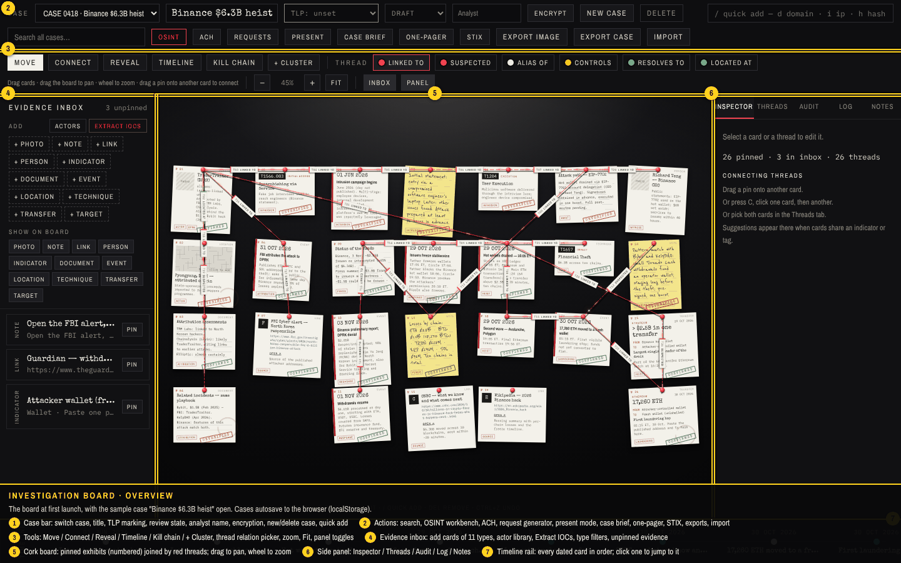

# Cyber Investigation Board

A noir-style investigation board for cyber intelligence work: pinned evidence cards, red-thread links, IOC extraction, ATT&CK techniques, an OSINT workbench, analysis of competing hypotheses, case briefs and STIX 2.1 export. Runs entirely in the browser; cases are saved to `localStorage` (optionally AES-GCM encrypted).



- **[Feature guide](docs/FEATURES.md)** — every function with a labelled screenshot.
- **[Worked investigation](docs/TUTORIAL.md)** — a real October 2026 campaign (vendor-themed Okta / ServiceNow vishing against e-commerce SaaS providers) built up step by step, with instructions.
- **[Case file: SafePay ransomware](docs/CASE-SAFEPAY.md)** — a second real case (CISA advisory AA26-293A) that uses every feature: pictures on cards, OSINT on IPs / hashes / CVEs, VirusTotal and other pivots, clusters, merges, snapshots, playback, STIX round trip, encryption.
- **[Improvements log](docs/IMPROVEMENTS.md)** — problems met while building the cases, and the features or data that would fix them.
- **[Backend specification](docs/BACKEND-SPEC.md)** — data model and API for a multi-user server behind this front end.
- **[Verification report](docs/feature-check.json)** — the automated run that produced the screenshots, with a pass/fail line per feature.

## Run it

```bash
npm install
npm run dev
```

Open the URL Vite prints (default `http://localhost:5173`). `npm run build` writes a static site to `dist/`; `npm run preview` serves it. There is no backend: everything runs in the page, and the fonts load from Google Fonts.

## Keys

`V` move · `C` connect · `T` timeline · `K` kill chain · `R` reveal · `P` present · `F` fit · `O` OSINT · `/` quick add · `Del` remove · `Ctrl+Z` undo · `Esc` close / deselect

Quick-add commands: `d` domain · `i` ip · `h` hash · `m` email · `w` wallet · `cve` · `@` handle · `u` url · `e <date> <title>` event · `n` note · `p` person · `t T1566.004` technique · `l` location · `c` cluster. Without a command the value is auto-detected.

## How the code is organised

| Path | What it is |
| --- | --- |
| `design/Investigation Board.dc.html` | The original design file (Claude Design export) and its runtime `support.js`. Source of truth for the UI. |
| `tools/convert-template.mjs` | Converts the design file's template dialect (`{{ }}`, `sc-if`, `sc-for`, `style-hover`) into plain JSX. Re-run after editing the design file. |
| `src/App.jsx` | **Generated** JSX for the whole screen. |
| `src/logic.js` | The application logic class, carried over from the design file (state, board maths, exports, OSINT, STIX, ACH, …). |
| `src/dc.js` | A small shim: the logic base class, the style helper, and the React host that renders the template from `renderVals()`. |
| `src/settings.js` | Look & behaviour defaults from the design's property panel (paper, pins, thread style, lighting, defang, stale days, …). |
| `src/helmet.css`, `src/pseudo.css` | Generated global styles and the hover/focus rules. |
| `docs/` | Feature guide, tutorial, backend spec, screenshots, sample exports. |

### Regenerating from the design file

```bash
node tools/convert-template.mjs "design/Investigation Board.dc.html"
```

The converter needs Playwright's Chromium (it parses the template with a real DOM). It rewrites `src/App.jsx`, `src/pseudo.css` and `src/helmet.css`; `src/logic.js` is the design file's script with two small fixes applied (see below).

### Fixes applied to the design's logic

Both were found while exercising every feature in a browser and would have broken the original file in the same way:

1. **Board export / case brief / one-pager crashed when the case had a cluster.** `renderBoard()` drew the cluster rectangles before the canvas context existed. The drawing now happens after the context is created and translated.
2. **The passphrase (lock) screen crashed on load.** The locked initial state was missing the `extract`, `newFrom`, `newTo` and `newRel` fields that `renderVals()` reads. They are now initialised.

## Regenerating the screenshots and guides

The feature guide and the tutorial are produced by scripts that drive the built app in headless Chromium, assert each feature worked, and draw the labels on the captures. They need Playwright with Chromium available to `require('playwright')`.

```bash
npm run build
npx vite preview --port 4173
```

```bash
node tools/capture/features.cjs
```

```bash
node tools/capture/tutorial.cjs
```

```bash
node tools/capture/safepay.cjs
```

```bash
python3 tools/capture/compress.py
```

```bash
node tools/write-docs.mjs
```

The first script writes `docs/screenshots/*.png` and `docs/feature-check.json`; the second writes `docs/tutorial/*.png`, `docs/tutorial/tutorial-run.json` and the sample exports in `docs/exports/`; the third writes `docs/case-safepay/` (it uploads the pictures in `docs/case-safepay/evidence/`); the last two shrink the PNGs and rebuild `docs/FEATURES.md`, `docs/TUTORIAL.md` and `docs/CASE-SAFEPAY.md` from the captions recorded during the runs.

## Notes

- "Analyse with Claude" (Inspector) only works inside the Claude app preview; elsewhere it shows a toast.
- Live OSINT lookups use public endpoints that allow browser access (Google DNS, RDAP, …). Endpoints that refuse cross-origin requests (crt.sh, urlscan, ThreatFox, Wayback) fall back to launcher links; the console shows the refusals, which is expected.
- The two sample cases are seeded on first load: "Operation Lantern" (fictional phishing case) and "Binance $6.3B heist" (from the design file).
