# Feature guide

Every screenshot below was taken by an automated run that drives the real app in Chromium (see `docs/feature-check.json` for the pass/fail line of each check). Yellow numbers mark the controls described under each picture.

**Verification:** 41 of 41 checks passed.

Check list

| Result | Check | Detail |
| --- | --- | --- |
| PASS | initial render: two sample cases, Binance case active | CASE 0417 Operation Lantern \| CASE 0418 Binance $6.3B heist |
| PASS | case bar: set TLP, review state, analyst, title |  |
| PASS | quick add: "d" command pins a domain indicator | pinned 26 -> 27 |
| PASS | quick add: technique, CVE, event and note commands | pinned now 31 |
| PASS | inspector: select a card and edit title/body/tags/stamp | sel=imw9d6b2j6uqj |
| PASS | inspector: tasks and comments |  |
| PASS | inspector: pivots, custody, Claude button present | 5 pivot links |
| PASS | connect tool: C, click two cards, thread created | threads 26 -> 27 |
| PASS | thread editor opens for the new thread |  |
| PASS | reveal mode dims everything but the selection |  |
| PASS | timeline layout (T) |  |
| PASS | kill chain lanes (K) |  |
| PASS | + Cluster adds a group region |  |
| PASS | search dims non-matching cards and lists other-case hits |  |
| PASS | inbox: + Person adds an unpinned card; Pin moves it to the board | items 34->35, pinned 31->32 |
| PASS | inbox: type filter hides a card type |  |
| PASS | actor library: drop in a known group with its techniques | pinned 32 -> 37, threads 27 -> 31 |
| PASS | extract IOCs: paste report text, rows found, add to inbox | 7 rows; items 40 -> 46 |
| PASS | OSINT workbench: detect type and run lookups |  |
| PASS | ACH: add hypotheses and score evidence | 111 matrix cells |
| PASS | request generator: takedown letter from selected indicators | 1215 chars |
| PASS | threads tab: suggestions and manual thread | threads 31 -> 32 |
| PASS | audit tab: hygiene checks for indicators |  |
| PASS | log tab: snapshots, playback and the case log | snapshots 1, log entries 27 |
| PASS | notes tab: key judgement, sign-off and notes |  |
| PASS | present mode walks exhibits with arrow keys |  |
| PASS | case brief opens as a printable document | 13225 chars |
| PASS | one-pager opens as a printable document |  |
| PASS | download: STIX | case-0418-binance-6-3b-heist.stix.json (44976 bytes) |
| PASS | download: Export image | case-0418-binance-6-3b-heist.png (7367473 bytes) |
| PASS | download: Export case | case-0418-binance-6-3b-heist.json (83710 bytes) |
| PASS | STIX bundle is valid STIX 2.1 with indicators and relationships | {"report":1,"threat-actor":2,"location":1,"note":22,"attack-pattern":8,"identity":2,"x-cryptocurrency-transaction":2,"indicator":7,"vulnerability":1,"relationship":32,"grouping":2} |
| PASS | case export has the documented shape | format=cyber-investigation-board v1, 46 items |
| PASS | import: case JSON round-trips as a new case | cases 2 -> 3 (46 items) |
| PASS | import: CSV indicator list lands in the inbox | items 46 -> 49 |
| PASS | new case from the Phishing campaign template | CASE 0419 Phishing campaign · 8 items, 3 hypotheses, tlp amber |
| PASS | Delete key removes the selected card; Ctrl+Z restores it | 8 -> 7 -> 8 |
| PASS | zoom buttons, Fit, Inbox and Panel toggles |  |
| PASS | encrypt at rest: set passphrase, reload shows lock screen, unlock restores cases | 4 cases restored |
| PASS | mobile layout under 720px switches to list mode |  |
| PASS | no unexpected page errors during the run (OSINT CORS refusals are expected and handled) |  |

## Contents

- [Investigation Board · overview](#investigation-board-overview)
- [Case bar](#case-bar)
- [Quick add](#quick-add)
- [Inspector](#inspector)
- [Inspector · pivots and custody](#inspector-pivots-and-custody)
- [Connect tool and thread editor](#connect-tool-and-thread-editor)
- [Reveal](#reveal)
- [Timeline layout](#timeline-layout)
- [Kill-chain lanes](#kill-chain-lanes)
- [Clusters](#clusters)
- [Search](#search)
- [Evidence inbox](#evidence-inbox)
- [Actor library](#actor-library)
- [Extract IOCs](#extract-iocs)
- [OSINT workbench](#osint-workbench)
- [Analysis of competing hypotheses](#analysis-of-competing-hypotheses)
- [Request generator](#request-generator)
- [Threads tab](#threads-tab)
- [Audit tab](#audit-tab)
- [Snapshots, playback and log](#snapshots-playback-and-log)
- [Judgement and notes](#judgement-and-notes)
- [Presentation mode](#presentation-mode)
- [Exports and import](#exports-and-import)
- [New case](#new-case)
- [Encryption at rest](#encryption-at-rest)
- [Locked case files](#locked-case-files)
- [Mobile layout](#mobile-layout)

### Investigation Board · overview

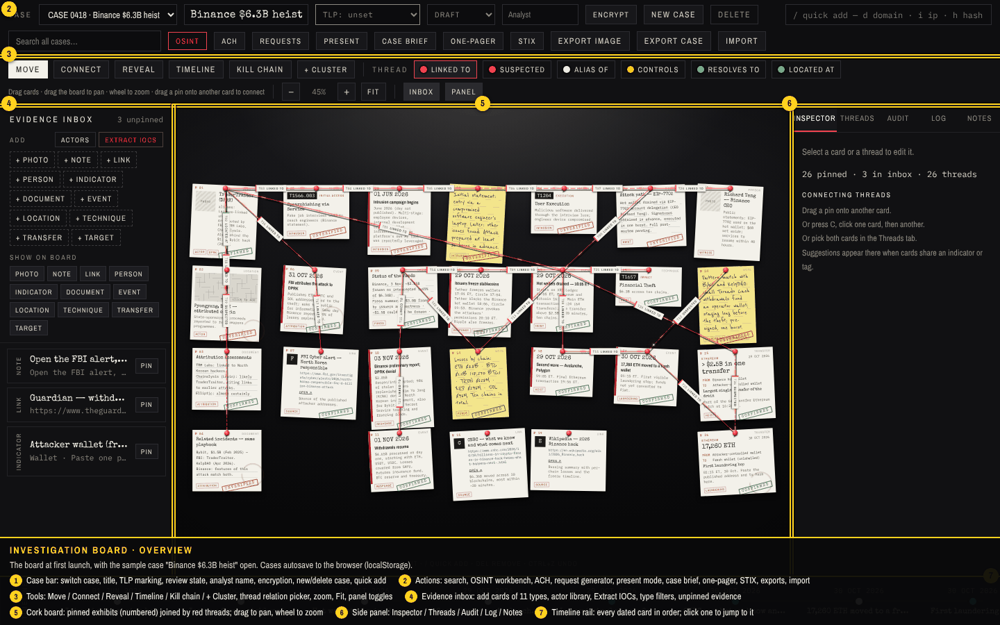

The board at first launch, with the sample case "Binance $6.3B heist" open. Cases autosave to the browser (localStorage).

1. Case bar: switch case, title, TLP marking, review state, analyst name, encryption, new/delete case, quick add
2. Actions: search, OSINT workbench, ACH, request generator, present mode, case brief, one-pager, STIX, exports, import
3. Tools: Move / Connect / Reveal / Timeline / Kill chain / + Cluster, thread relation picker, zoom, Fit, panel toggles
4. Evidence inbox: add cards of 11 types, actor library, Extract IOCs, type filters, unpinned evidence
5. Cork board: pinned exhibits (numbered) joined by red threads; drag to pan, wheel to zoom
6. Side panel: Inspector / Threads / Audit / Log / Notes
7. Timeline rail: every dated card in order; click one to jump to it

### Case bar

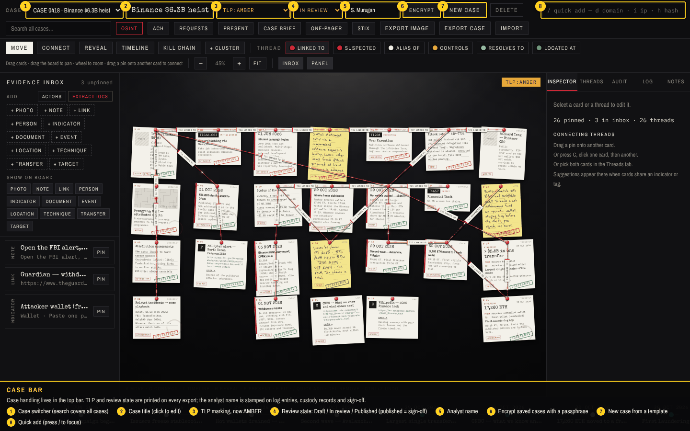

Case handling lives in the top bar. TLP and review state are printed on every export; the analyst name is stamped on log entries, custody records and sign-off.

1. Case switcher (search covers all cases)
2. Case title (click to edit)
3. TLP marking, now AMBER
4. Review state: Draft / In review / Published (published = sign-off)
5. Analyst name
6. Encrypt saved cases with a passphrase
7. New case from a template
8. Quick add (press / to focus)

### Quick add

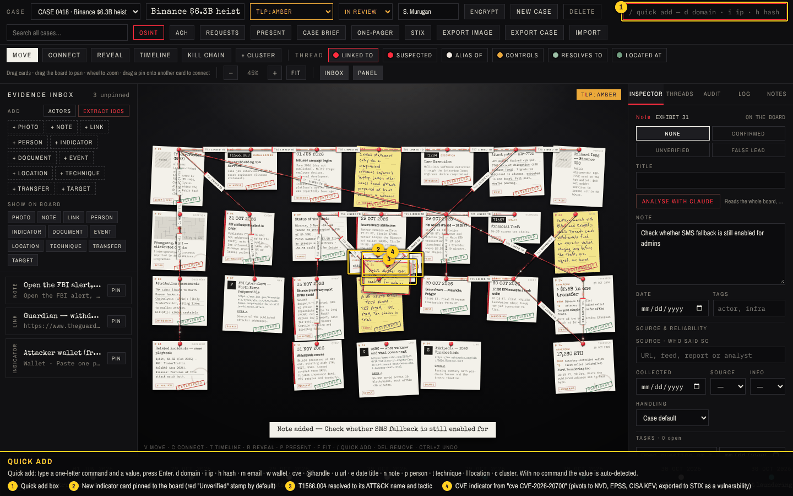

Quick add: type a one-letter command and a value, press Enter. d domain · i ip · h hash · m email · w wallet · cve · @handle · u url · e date title · n note · p person · t technique · l location · c cluster. With no command the value is auto-detected.

1. Quick add box
2. New indicator card pinned to the board (red "Unverified" stamp by default)
3. T1566.004 resolved to its ATT&CK name and tactic
4. CVE indicator from "cve CVE-2026-20700" (pivots to NVD, EPSS, CISA KEV; exported to STIX as a vulnerability)

### Inspector

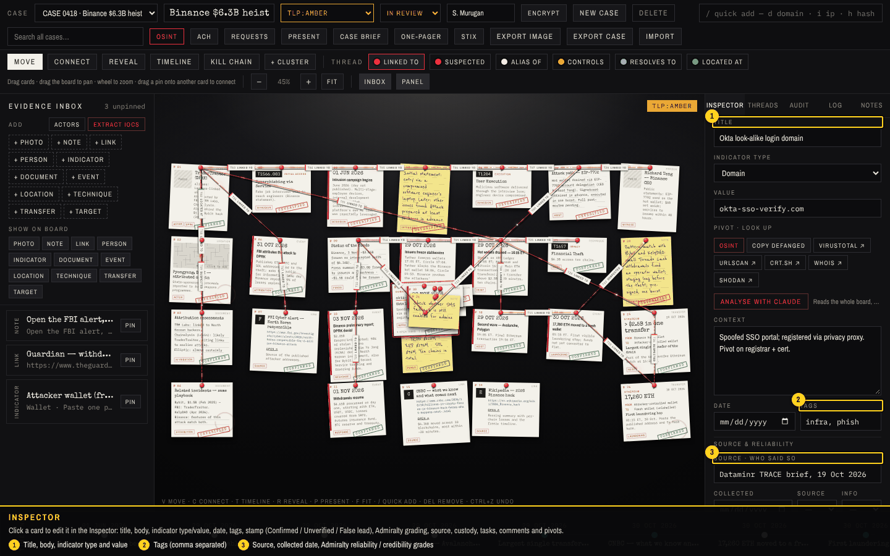

Click a card to edit it in the Inspector: title, body, indicator type/value, date, tags, stamp (Confirmed / Unverified / False lead), Admiralty grading, source, custody, tasks, comments and pivots.

1. Title, body, indicator type and value
2. Tags (comma separated)
3. Source, collected date, Admiralty reliability / credibility grades

### Inspector · pivots and custody

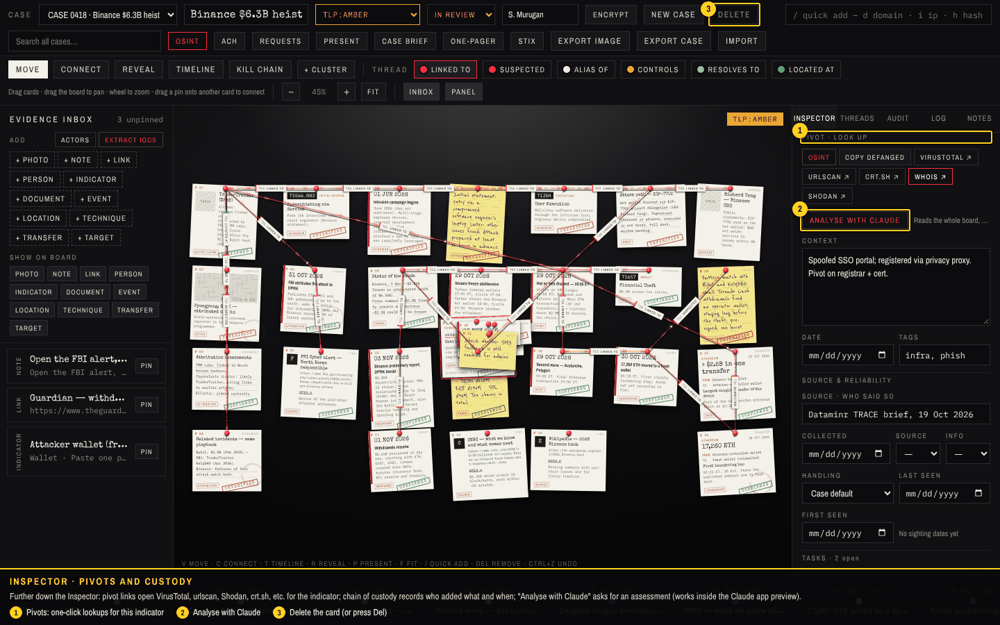

Further down the Inspector: pivot links open VirusTotal, urlscan, Shodan, crt.sh, etc. for the indicator; chain of custody records who added what and when; "Analyse with Claude" asks for an assessment (works inside the Claude app preview).

1. Pivots: one-click lookups for this indicator
2. Analyse with Claude
3. Delete the card (or press Del)

### Connect tool and thread editor

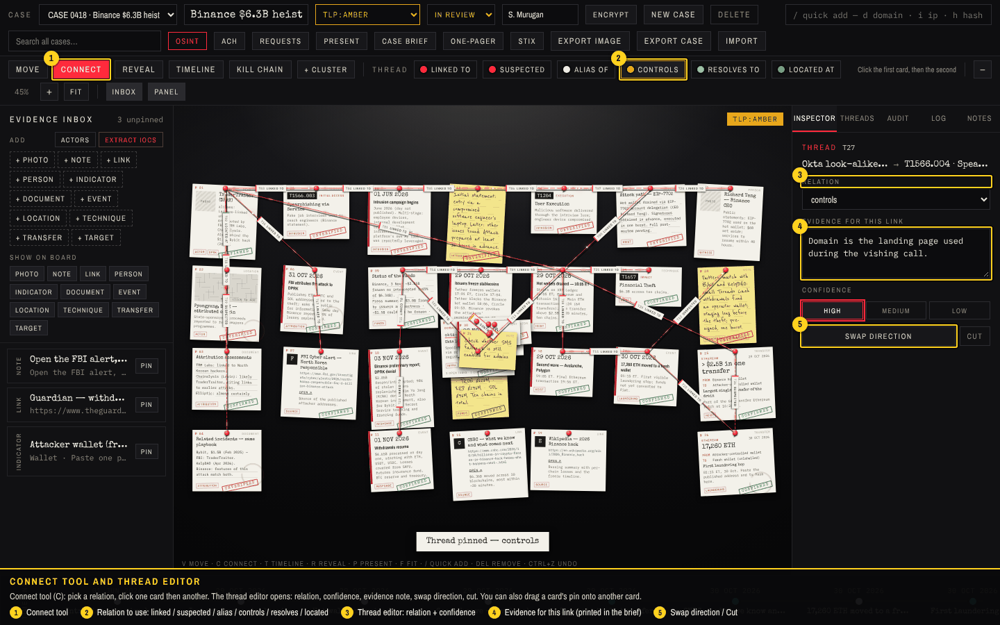

Connect tool (C): pick a relation, click one card then another. The thread editor opens: relation, confidence, evidence note, swap direction, cut. You can also drag a card's pin onto another card.

1. Connect tool
2. Relation to use: linked / suspected / alias / controls / resolves / located
3. Thread editor: relation + confidence
4. Evidence for this link (printed in the brief)
5. Swap direction / Cut

### Reveal

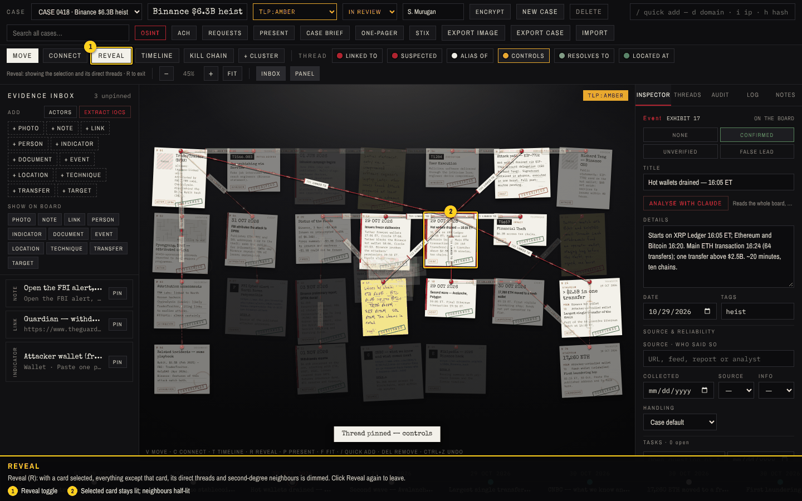

Reveal (R): with a card selected, everything except that card, its direct threads and second-degree neighbours is dimmed. Click Reveal again to leave.

1. Reveal toggle
2. Selected card stays lit; neighbours half-lit

### Timeline layout

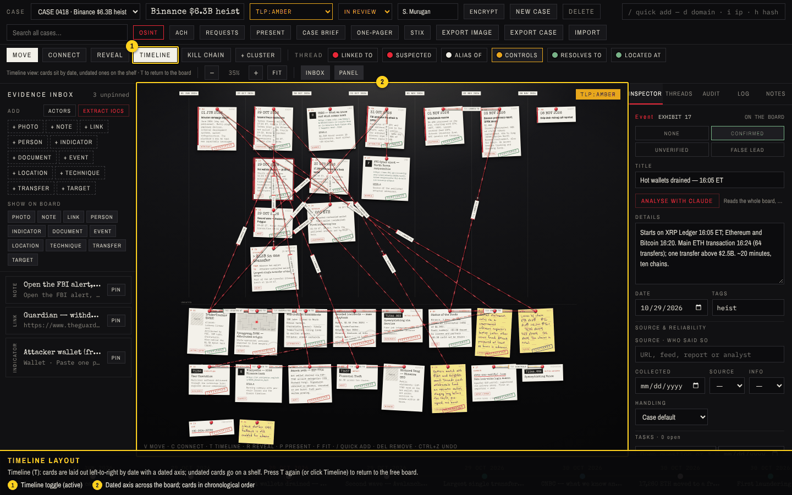

Timeline (T): cards are laid out left-to-right by date with a dated axis; undated cards go on a shelf. Press T again (or click Timeline) to return to the free board.

1. Timeline toggle (active)
2. Dated axis across the board; cards in chronological order

### Kill-chain lanes

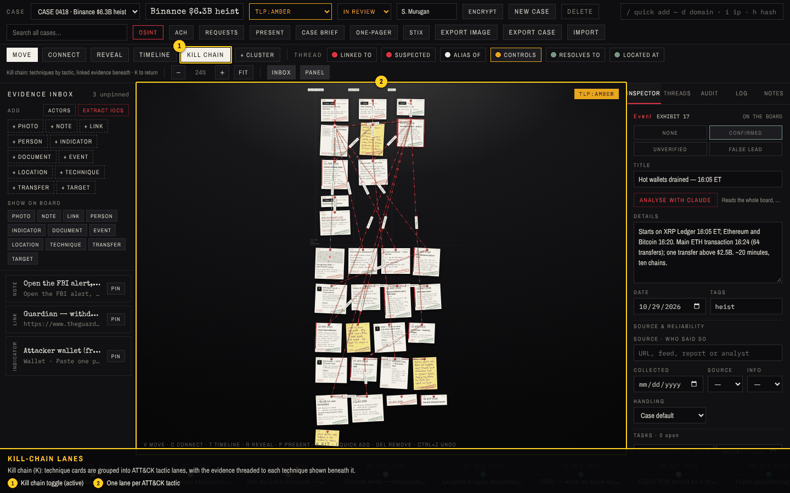

Kill chain (K): technique cards are grouped into ATT&CK tactic lanes, with the evidence threaded to each technique shown beneath it.

1. Kill chain toggle (active)
2. One lane per ATT&CK tactic

### Clusters

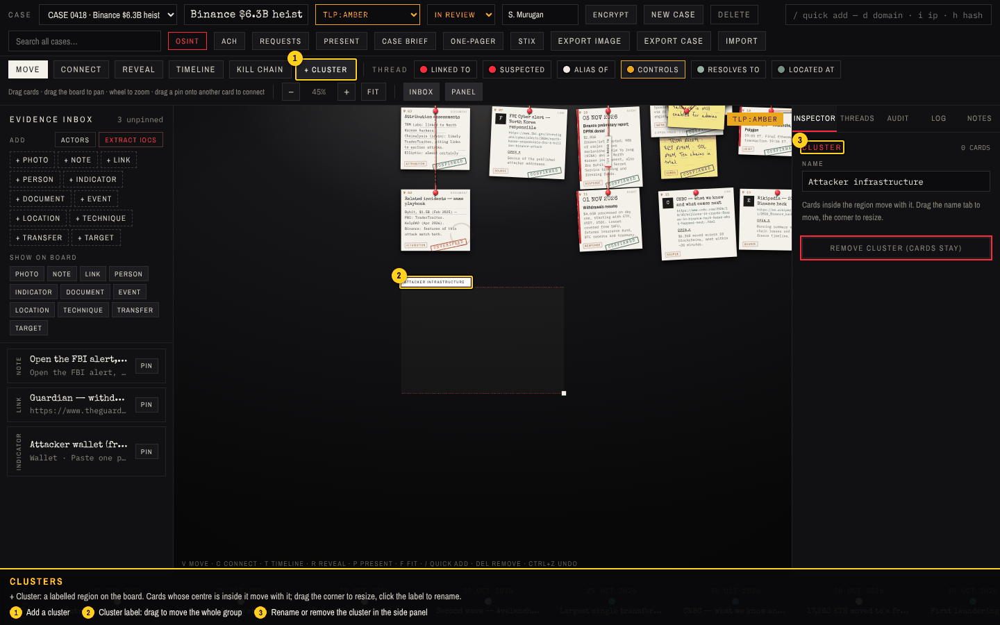

+ Cluster: a labelled region on the board. Cards whose centre is inside it move with it; drag the corner to resize, click the label to rename.

1. Add a cluster
2. Cluster label: drag to move the whole group
3. Rename or remove the cluster in the side panel

### Search

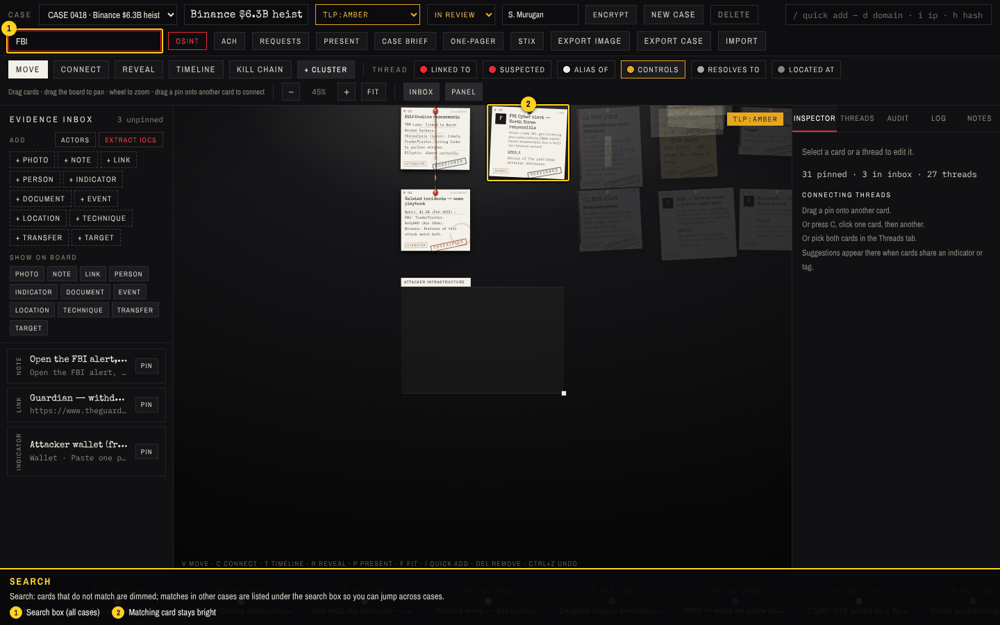

Search: cards that do not match are dimmed; matches in other cases are listed under the search box so you can jump across cases.

1. Search box (all cases)
2. Matching card stays bright

### Evidence inbox

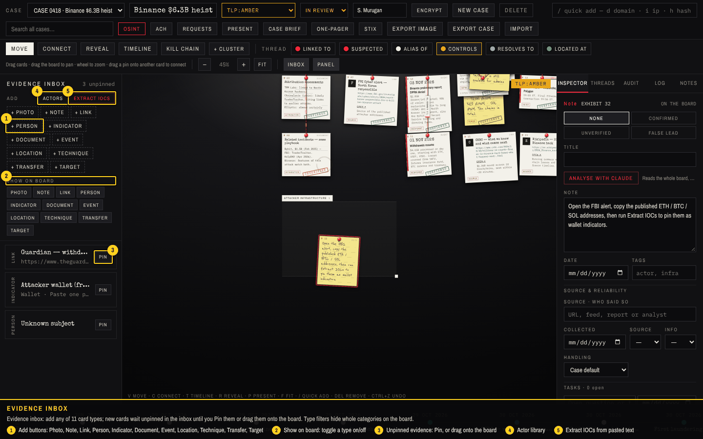

Evidence inbox: add any of 11 card types; new cards wait unpinned in the inbox until you Pin them or drag them onto the board. Type filters hide whole categories on the board.

1. Add buttons: Photo, Note, Link, Person, Indicator, Document, Event, Location, Technique, Transfer, Target
2. Show on board: toggle a type on/off
3. Unpinned evidence: Pin, or drag onto the board
4. Actor library
5. Extract IOCs from pasted text

### Actor library

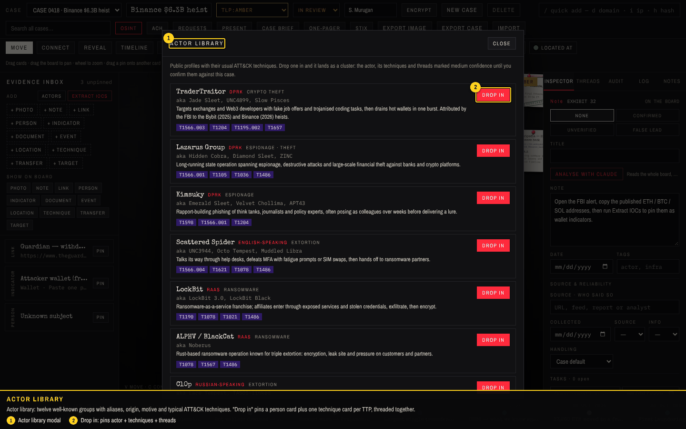

Actor library: twelve well-known groups with aliases, origin, motive and typical ATT&CK techniques. "Drop in" pins a person card plus one technique card per TTP, threaded together.

1. Actor library modal
2. Drop in: pins actor + techniques + threads

### Extract IOCs

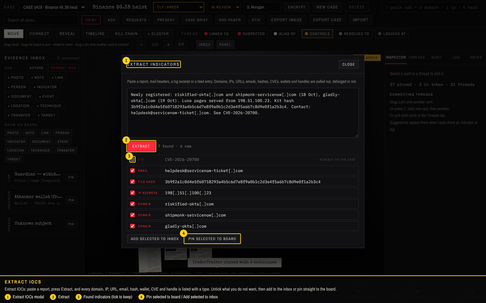

Extract IOCs: paste a report, press Extract, and every domain, IP, URL, email, hash, wallet, CVE and handle is listed with a type. Untick what you do not want, then add to the inbox or pin straight to the board.

1. Extract IOCs modal
2. Extract
3. Found indicators (tick to keep)
4. Pin selected to board / Add selected to inbox

### OSINT workbench

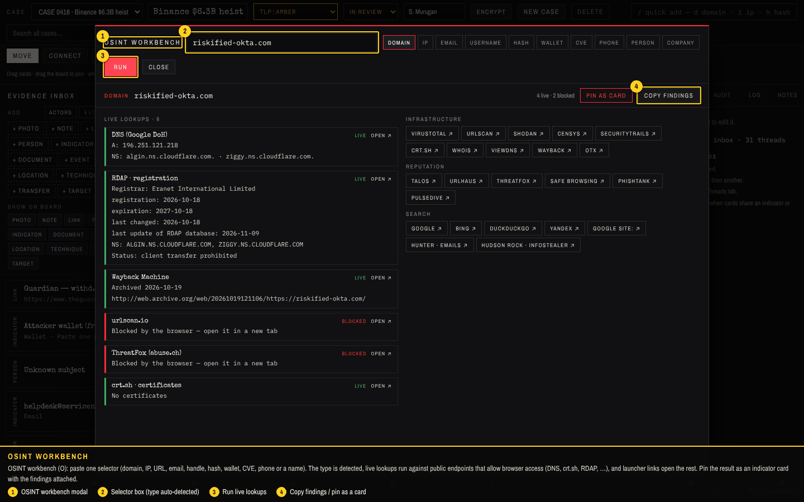

OSINT workbench (O): paste one selector (domain, IP, URL, email, handle, hash, wallet, CVE, phone or a name). The type is detected, live lookups run against public endpoints that allow browser access (DNS, crt.sh, RDAP, …), and launcher links open the rest. Pin the result as an indicator card with the findings attached.

1. OSINT workbench modal
2. Selector box (type auto-detected)
3. Run live lookups
4. Copy findings / pin as a card

### Analysis of competing hypotheses

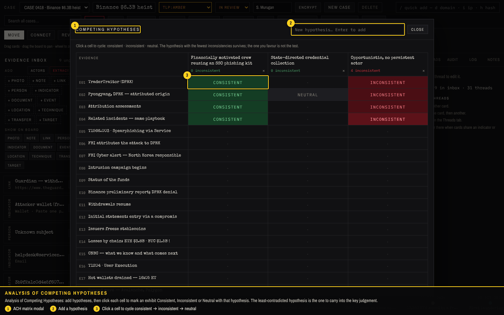

Analysis of Competing Hypotheses: add hypotheses, then click each cell to mark an exhibit Consistent, Inconsistent or Neutral with that hypothesis. The least-contradicted hypothesis is the one to carry into the key judgement.

1. ACH matrix modal
2. Add a hypothesis
3. Click a cell to cycle consistent → inconsistent → neutral

### Request generator

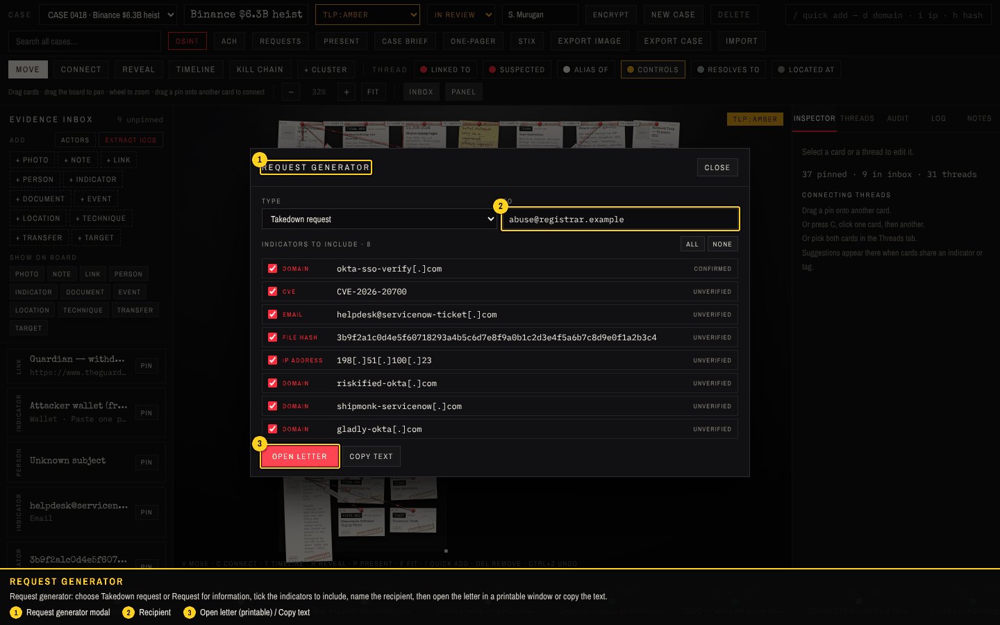

Request generator: choose Takedown request or Request for information, tick the indicators to include, name the recipient, then open the letter in a printable window or copy the text.

1. Request generator modal
2. Recipient
3. Open letter (printable) / Copy text

### Threads tab

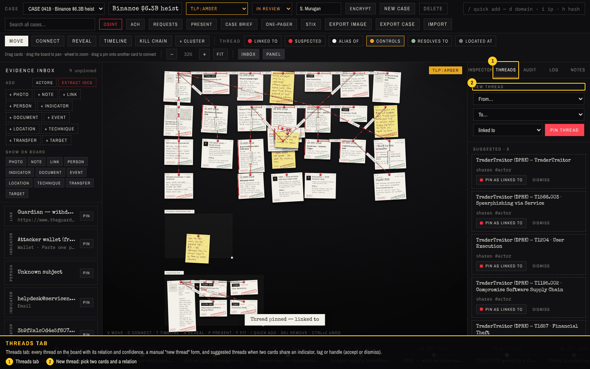

Threads tab: every thread on the board with its relation and confidence, a manual "new thread" form, and suggested threads when two cards share an indicator, tag or handle (accept or dismiss).

1. Threads tab
2. New thread: pick two cards and a relation

### Audit tab

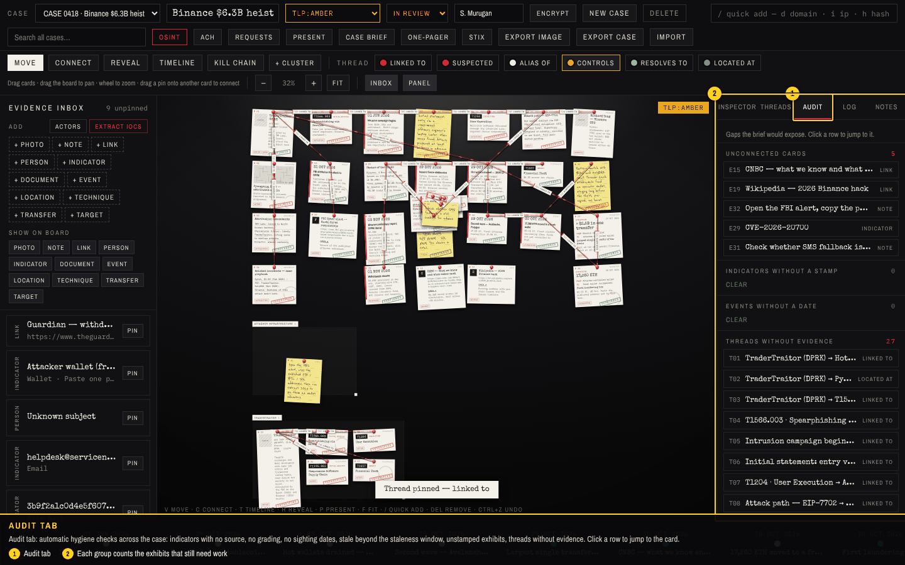

Audit tab: automatic hygiene checks across the case: indicators with no source, no grading, no sighting dates, stale beyond the staleness window, unstamped exhibits, threads without evidence. Click a row to jump to the card.

1. Audit tab
2. Each group counts the exhibits that still need work

### Snapshots, playback and log

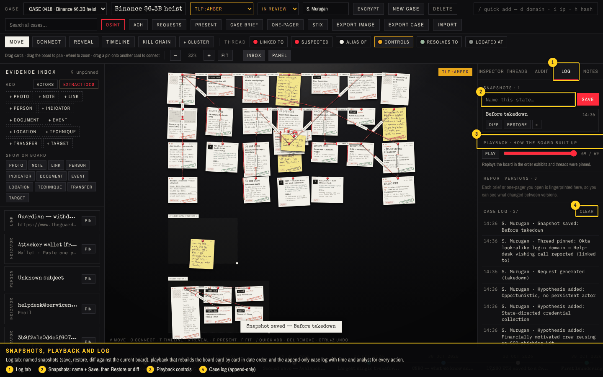

Log tab: named snapshots (save, restore, diff against the current board), playback that rebuilds the board card by card in date order, and the append-only case log with time and analyst for every action.

1. Log tab
2. Snapshots: name + Save, then Restore or diff
3. Playback controls
4. Case log (append-only)

### Judgement and notes

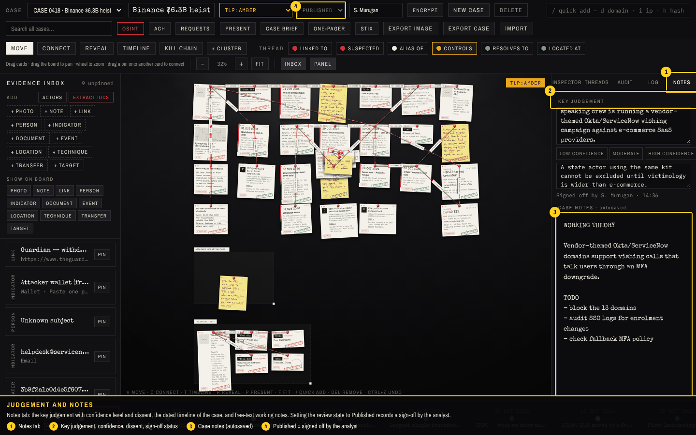

Notes tab: the key judgement with confidence level and dissent, the dated timeline of the case, and free-text working notes. Setting the review state to Published records a sign-off by the analyst.

1. Notes tab
2. Key judgement, confidence, dissent, sign-off status
3. Case notes (autosaved)
4. Published = signed off by the analyst

### Presentation mode

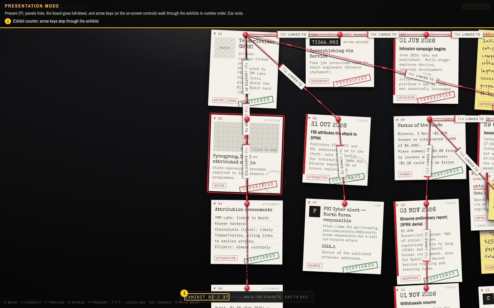

Present (P): panels hide, the board goes full-bleed, and arrow keys (or the on-screen controls) walk through the exhibits in number order. Esc exits.

1. Exhibit counter; arrow keys step through the exhibits

### Exports and import

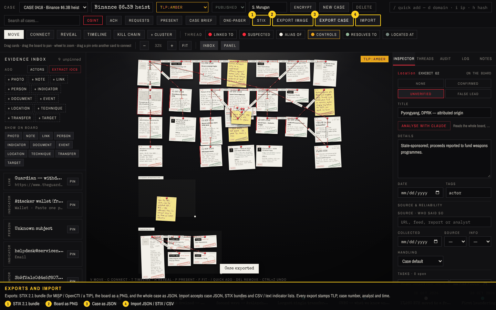

Exports: STIX 2.1 bundle (for MISP / OpenCTI / a TIP), the board as a PNG, and the whole case as JSON. Import accepts case JSON, STIX bundles and CSV / text indicator lists. Every export stamps TLP, case number, analyst and time.

1. STIX 2.1 bundle
2. Board as PNG
3. Case as JSON
4. Import JSON / STIX / CSV

### New case

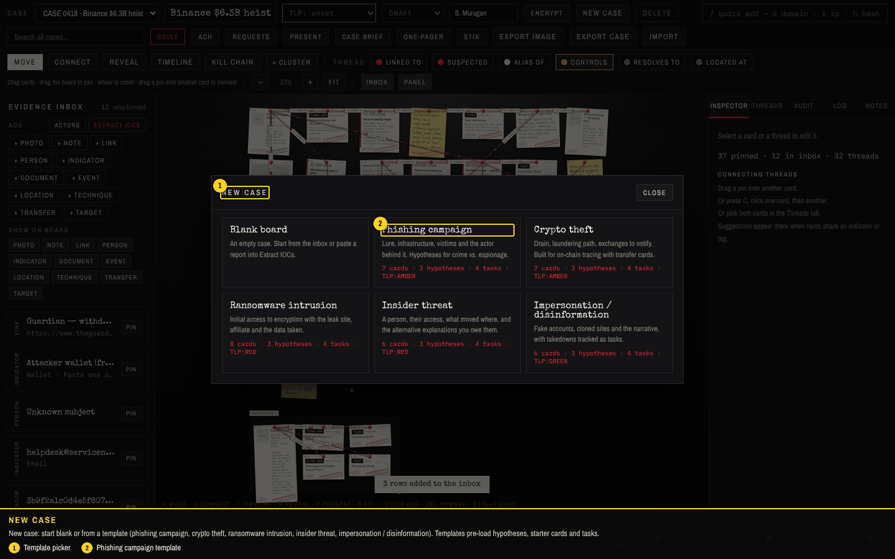

New case: start blank or from a template (phishing campaign, crypto theft, ransomware intrusion, insider threat, impersonation / disinformation). Templates pre-load hypotheses, starter cards and tasks.

1. Template picker
2. Phishing campaign template

### Encryption at rest

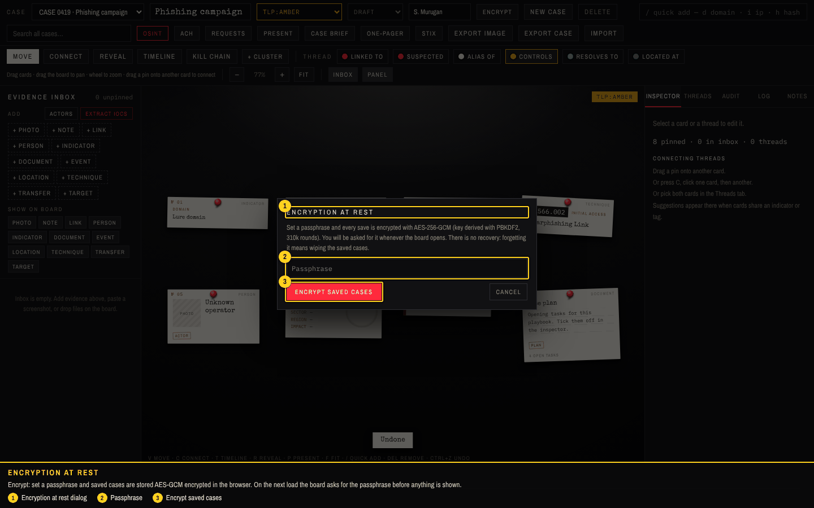

Encrypt: set a passphrase and saved cases are stored AES-GCM encrypted in the browser. On the next load the board asks for the passphrase before anything is shown.

1. Encryption at rest dialog
2. Passphrase
3. Encrypt saved cases

### Locked case files

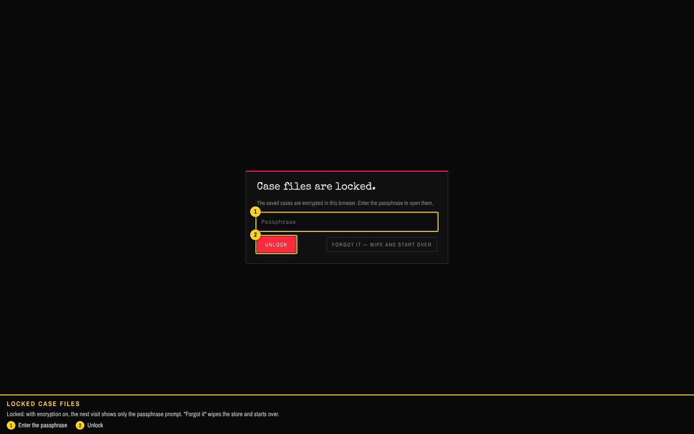

Locked: with encryption on, the next visit shows only the passphrase prompt. "Forgot it" wipes the store and starts over.

1. Enter the passphrase
2. Unlock

### Mobile layout

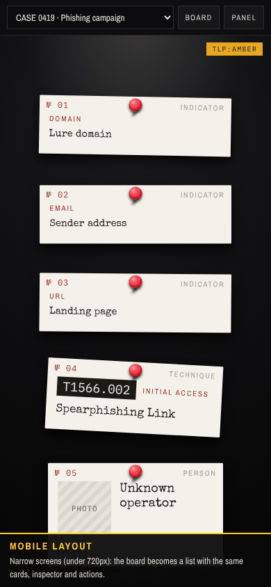

Narrow screens (under 720px): the board becomes a list with the same cards, inspector and actions.

## Generated documents

### Takedown request letter

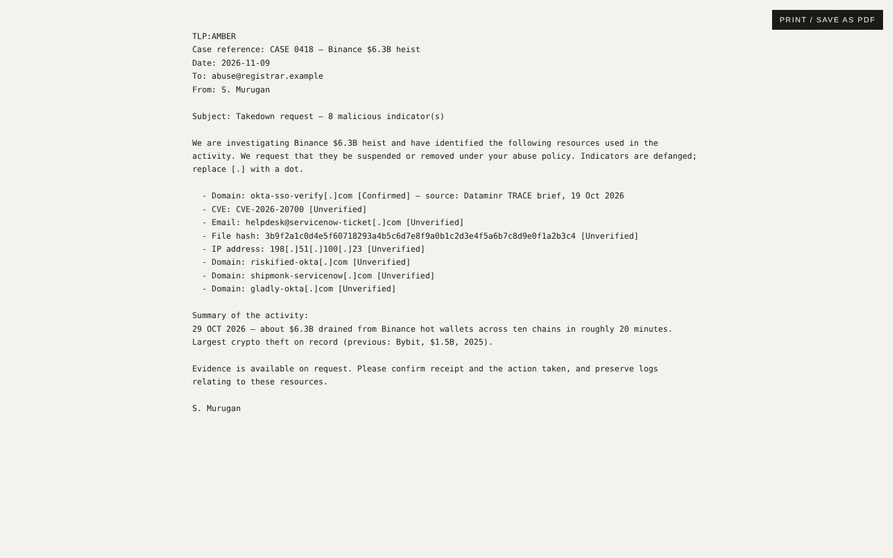

The letter the request generator opens in a new window: indicators defanged, case number, TLP, analyst and date.

### Case brief

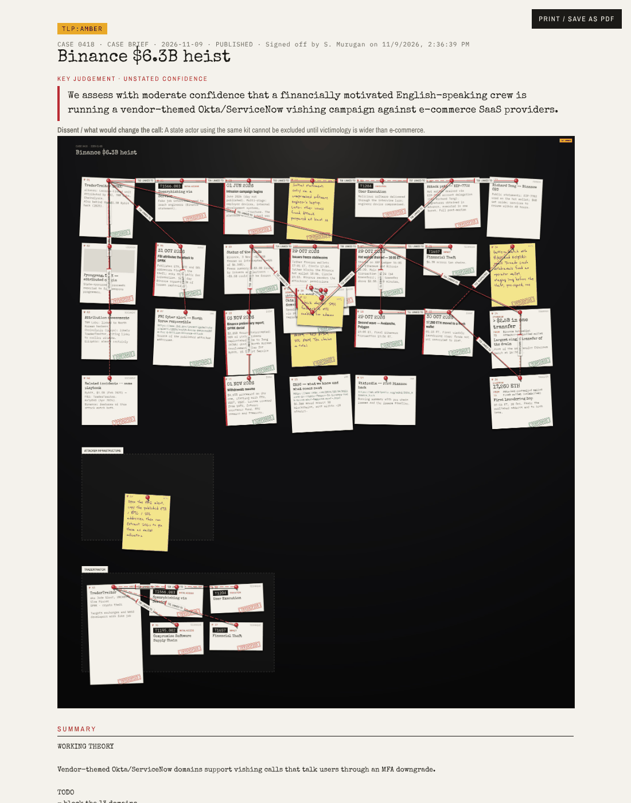

The printable case brief: judgement, exhibits with stamps and grades, threads with their evidence, timeline, tasks and the board image. Save it as PDF from the print dialog.

### Executive one-pager

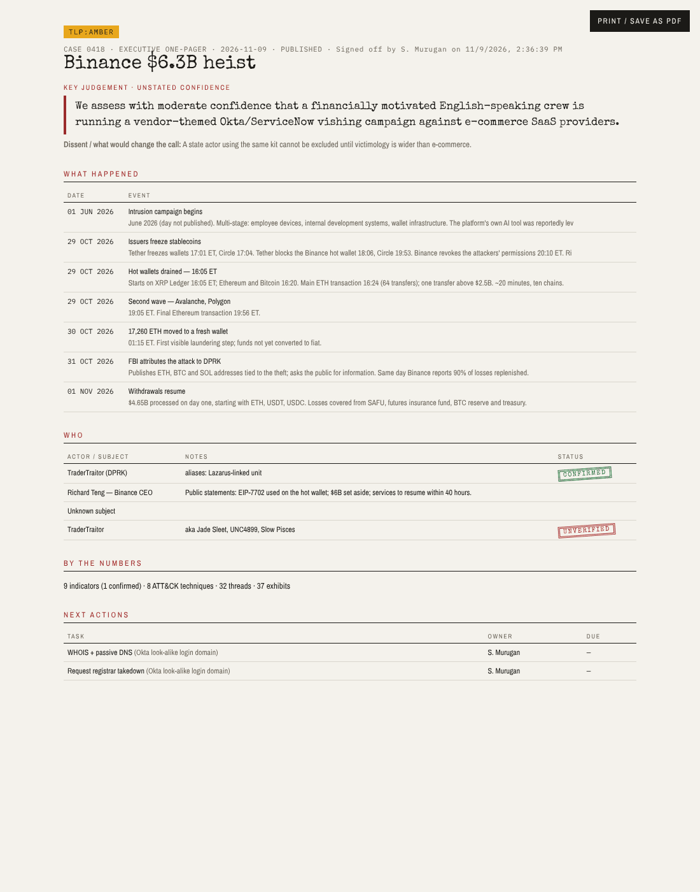

The one-page version: judgement, confidence, what happened, next actions.

### Board exported as PNG

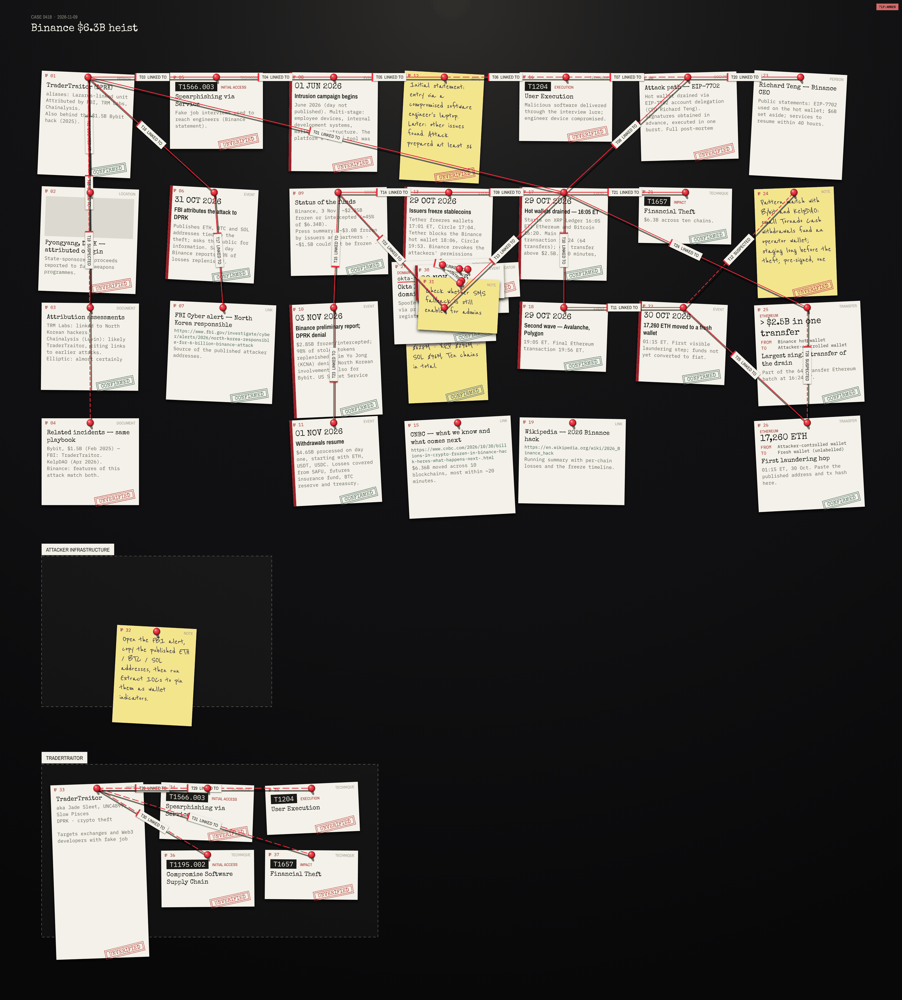

What "Export image" downloads: the whole board rendered to a high-resolution PNG with the case number and date.

