# Worked investigation: vendor-themed Okta / ServiceNow vishing wave

This walkthrough builds a real, recent case on the board from nothing, one step at a time, and shows which control to use at each step. Every screenshot was captured from the running app; yellow numbers mark the controls mentioned in the text.

## The event

On 19 October 2026 Dataminr's threat research team (TRACE) published an intel brief on an **Okta-themed phishing campaign against e-commerce providers**. The essentials, as reported:

- **Who is hit:** B2B e-commerce SaaS and infrastructure providers: marketing and customer-engagement platforms, logistics partners, payment and fraud-prevention providers. Several were targeted more than once. The assessed motive is downstream third-party breach leverage for data extortion.
- **How it works:** look-alike Okta and ServiceNow SSO portals on domains that pair a vendor name with "okta" or "servicenow" (for example `gladly-okta[.]com`, `shipmonk-servicenow[.]com`). The pages back up **voice phishing**: the caller walks the user through an **MFA downgrade**, getting past YubiKey hardware keys wherever policy still allows an SMS or email code as a fallback.
- **When:** domain registration waves since late July 2026; the e-commerce targeting pattern from September; `riskified-okta[.]com` and `shipmonk-servicenow[.]com` registered 18 October, `gladly-okta[.]com` about 20 hours later.
- **Who:** linked with high confidence to earlier English-language cybercrime activity with the same targeting. No group is named.
- **Indicators (13 domains):** gladly-okta[.]com, riskified-okta[.]com, shipmonk-servicenow[.]com, yotpo-okta[.]com, paddleokta[.]com, moengageinc-okta[.]com, vzw-web-portal[.]com, listrak-okta[.]com, oktadialpad[.]com, servicenow-ticket2478[.]com, servicenow-ticket2829[.]com, servicenow-ticket[.]com, attentive-okta[.]com.

Source: Dataminr TRACE, [Okta-Themed Phishing Campaign Targets E-commerce Providers](https://www.dataminr.com/resources/intel-brief/okta-themed-phishing-campain-targets-e-commerce-providers/), 19 October 2026. Only facts from that brief are used below; nothing is attributed beyond it.

## What you will do

1. Start a case from the **Phishing campaign** template.
2. Pin the source and pull all 13 domains out of the report with **Extract IOCs**.
3. Edit the operator and target cards; delete placeholders you do not need.
4. Add ATT&CK techniques, dated events and analyst notes with **quick add**.
5. Arrange the board by dragging.
6. **Connect** the evidence with threads and record why each link exists.
7. Pivot on a domain in the **OSINT workbench**.
8. **Stamp and grade** the key indicators; add follow-up tasks.
9. Test the hypotheses in **ACH**.
10. Write the **key judgement**, save a snapshot, move the case to review.
11. Read the case as a **timeline** and as **kill-chain lanes**.
12. Generate a **takedown request**.
13. Export the **case brief**, a **STIX bundle** and the **case JSON**.

Each step below names the control, what to type, and what you should see.

## Steps

### Step 1 · Start the case

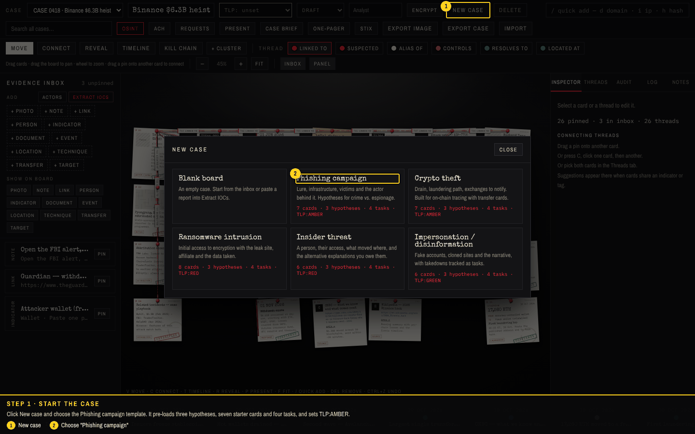

Click New case and choose the Phishing campaign template. It pre-loads three hypotheses, seven starter cards and four tasks, and sets TLP:AMBER.

1. New case
2. Choose "Phishing campaign"

### Step 1 · The empty case

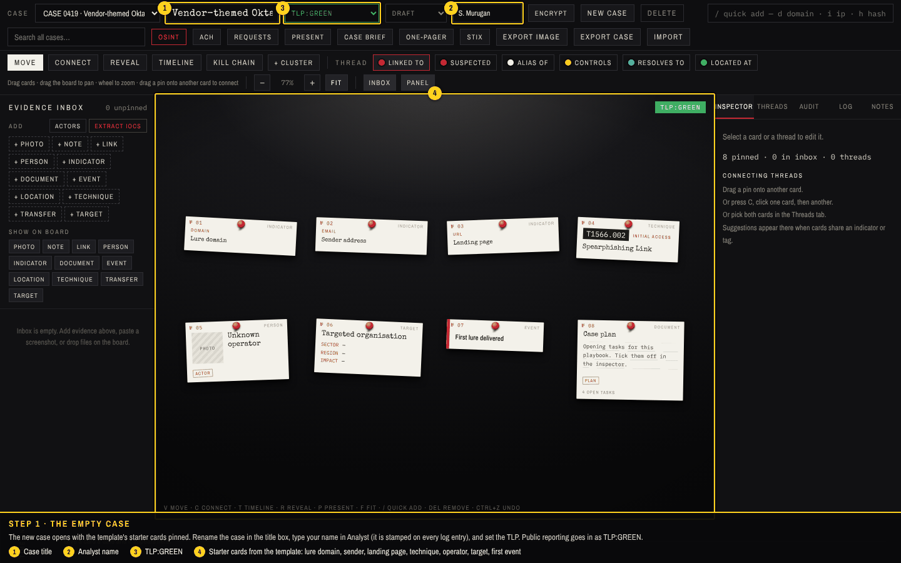

The new case opens with the template's starter cards pinned. Rename the case in the title box, type your name in Analyst (it is stamped on every log entry), and set the TLP. Public reporting goes in as TLP:GREEN.

1. Case title
2. Analyst name
3. TLP:GREEN
4. Starter cards from the template: lure domain, sender, landing page, technique, operator, target, first event

### Step 2 · Pull the indicators out of the report

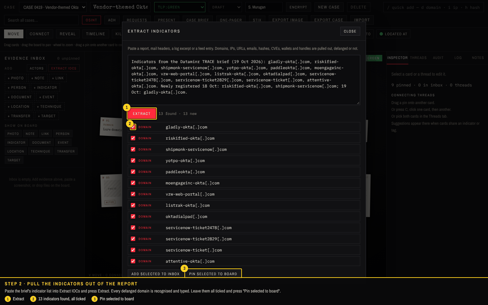

Paste the brief's indicator list into Extract IOCs and press Extract. Every defanged domain is recognised and typed. Leave them all ticked and press "Pin selected to board".

1. Extract
2. 13 indicators found, all ticked
3. Pin selected to board

### Step 3 · Flesh out the actors and victims

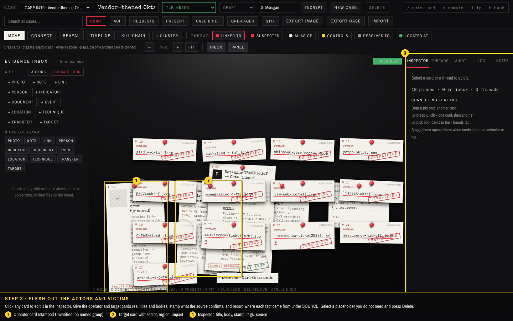

Click any card to edit it in the Inspector. Give the operator and target cards real titles and bodies, stamp what the source confirms, and record where each fact came from under SOURCE. Select a placeholder you do not need and press Delete.

1. Operator card (stamped Unverified: no named group)
2. Target card with sector, region, impact
3. Inspector: title, body, stamp, tags, source

### Step 5 · Arrange the evidence

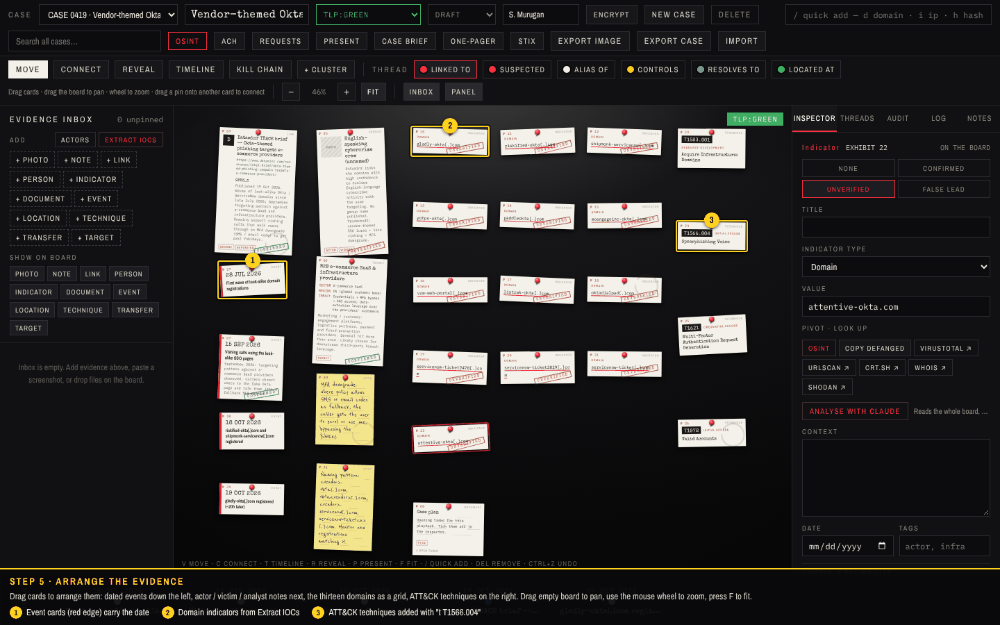

Drag cards to arrange them: dated events down the left, actor / victim / analyst notes next, the thirteen domains as a grid, ATT&CK techniques on the right. Drag empty board to pan, use the mouse wheel to zoom, press F to fit.

1. Event cards (red edge) carry the date
2. Domain indicators from Extract IOCs
3. ATT&CK techniques added with "t T1566.004"

### Step 6 · Thread the evidence

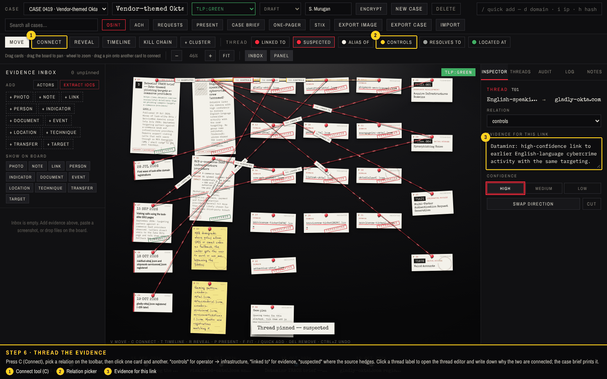

Press C (Connect), pick a relation on the toolbar, then click one card and another. "controls" for operator → infrastructure, "linked to" for evidence, "suspected" where the source hedges. Click a thread label to open the thread editor and write down why the two are connected; the case brief prints it.

1. Connect tool (C)
2. Relation picker
3. Evidence for this link

### Step 7 · Pivot on an indicator

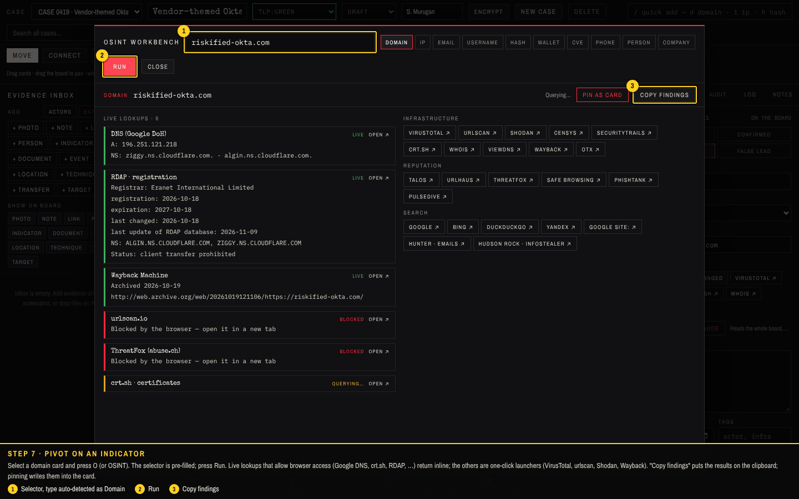

Select a domain card and press O (or OSINT). The selector is pre-filled; press Run. Live lookups that allow browser access (Google DNS, crt.sh, RDAP, …) return inline; the others are one-click launchers (VirusTotal, urlscan, Shodan, Wayback). "Copy findings" puts the results on the clipboard; pinning writes them into the card.

1. Selector, type auto-detected as Domain
2. Run
3. Copy findings

### Step 8 · Grade the evidence

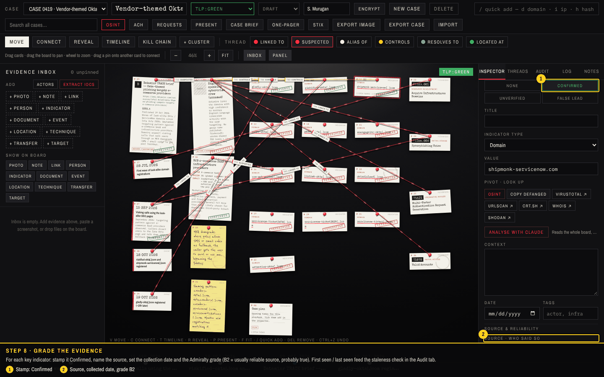

For each key indicator: stamp it Confirmed, name the source, set the collection date and the Admiralty grade (B2 = usually reliable source, probably true). First seen / last seen feed the staleness check in the Audit tab.

1. Stamp: Confirmed
2. Source, collected date, grade B2

### Step 8 · Tasks and comments

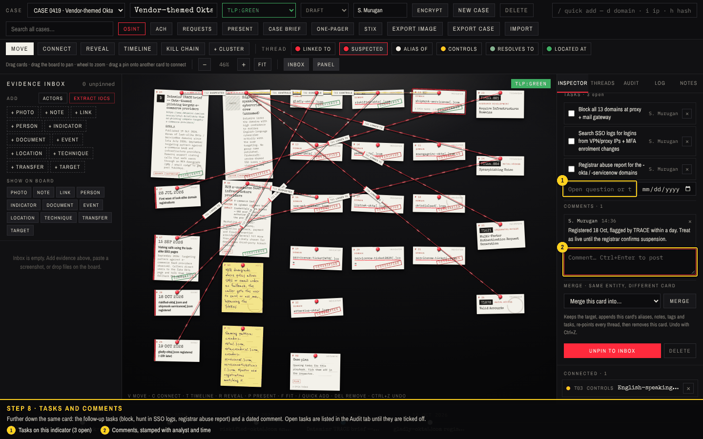

Further down the same card: the follow-up tasks (block, hunt in SSO logs, registrar abuse report) and a dated comment. Open tasks are listed in the Audit tab until they are ticked off.

1. Tasks on this indicator (3 open)
2. Comments, stamped with analyst and time

### Step 9 · Test the hypotheses

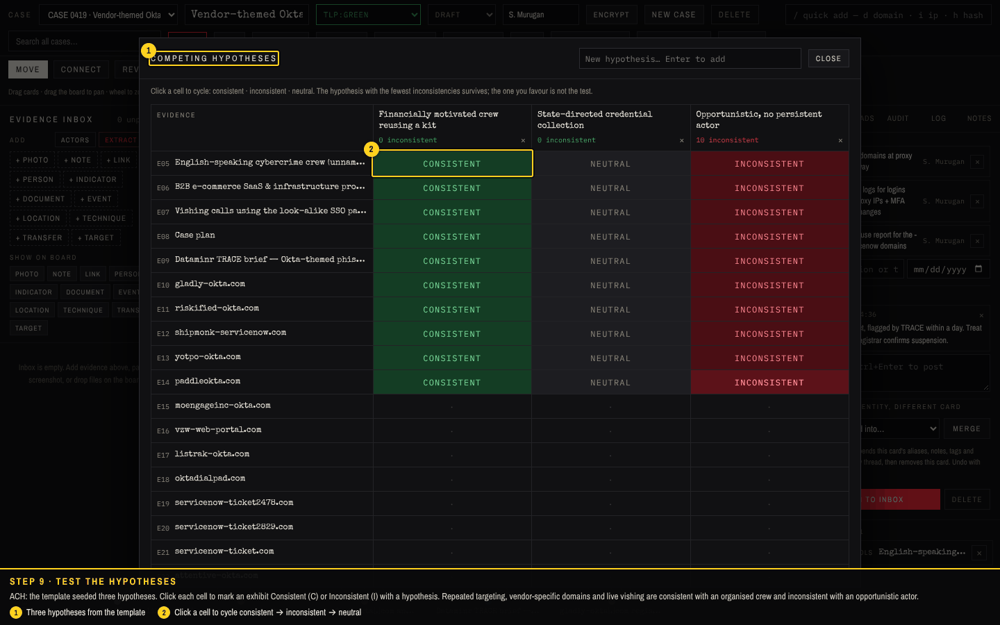

ACH: the template seeded three hypotheses. Click each cell to mark an exhibit Consistent (C) or Inconsistent (I) with a hypothesis. Repeated targeting, vendor-specific domains and live vishing are consistent with an organised crew and inconsistent with an opportunistic actor.

1. Three hypotheses from the template
2. Click a cell to cycle consistent → inconsistent → neutral

### Step 10 · Write the judgement

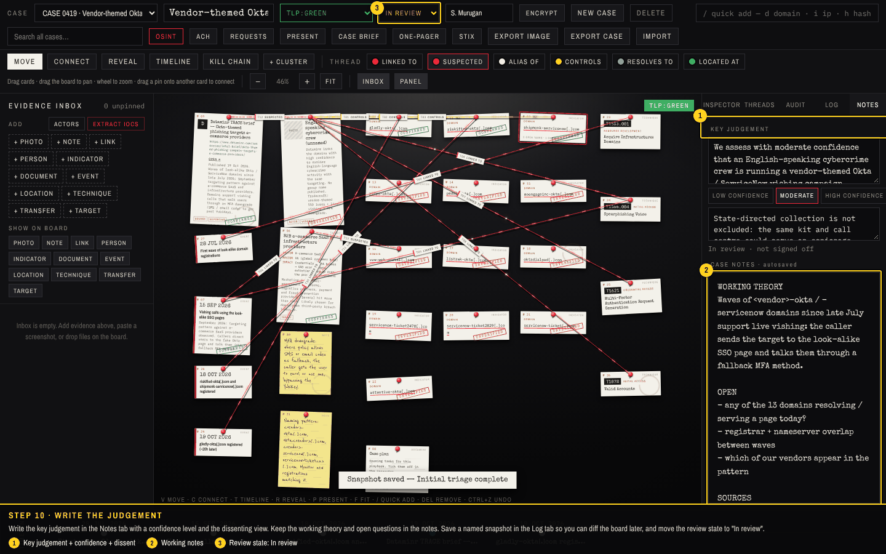

Write the key judgement in the Notes tab with a confidence level and the dissenting view. Keep the working theory and open questions in the notes. Save a named snapshot in the Log tab so you can diff the board later, and move the review state to "In review".

1. Key judgement + confidence + dissent
2. Working notes
3. Review state: In review

### Step 11 · Timeline

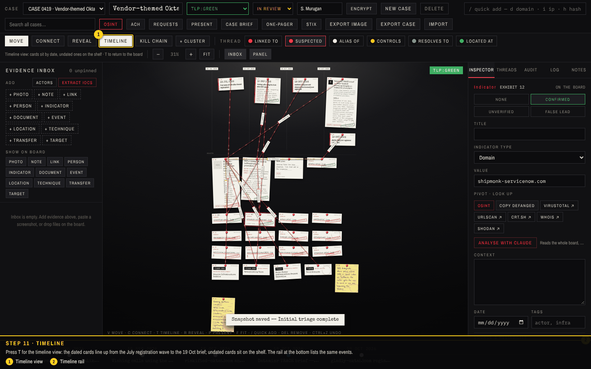

Press T for the timeline view: the dated cards line up from the July registration wave to the 19 Oct brief; undated cards sit on the shelf. The rail at the bottom lists the same events.

1. Timeline view
2. Timeline rail

### Step 11 · Kill chain

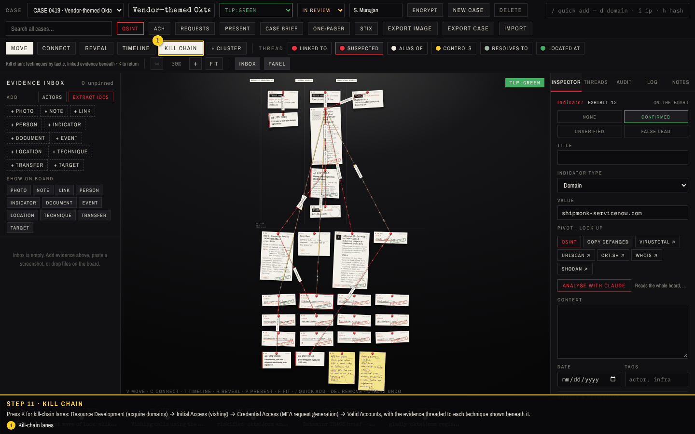

Press K for kill-chain lanes: Resource Development (acquire domains) → Initial Access (vishing) → Credential Access (MFA request generation) → Valid Accounts, with the evidence threaded to each technique shown beneath it.

1. Kill-chain lanes

### Step 12 · Ask for the takedown

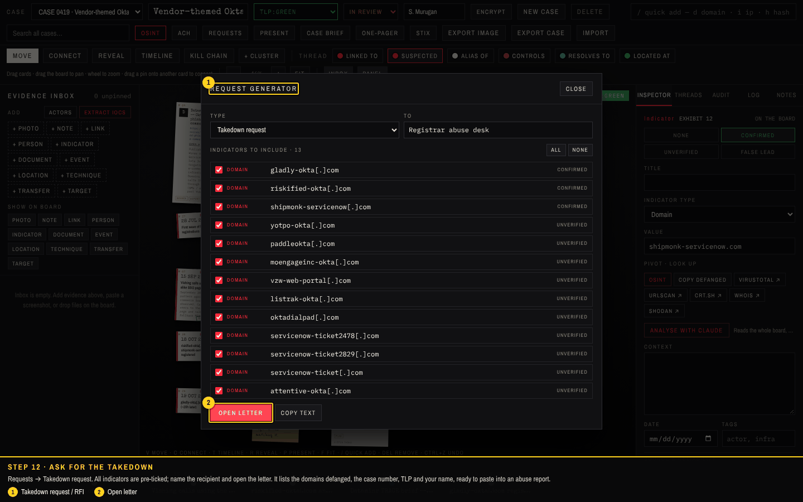

Requests → Takedown request. All indicators are pre-ticked; name the recipient and open the letter. It lists the domains defanged, the case number, TLP and your name, ready to paste into an abuse report.

1. Takedown request / RFI
2. Open letter

### Step 13 · Report and share

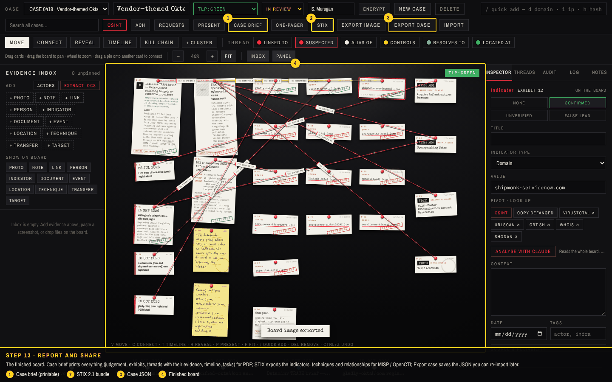

The finished board. Case brief prints everything (judgement, exhibits, threads with their evidence, timeline, tasks) for PDF; STIX exports the indicators, techniques and relationships for MISP / OpenCTI; Export case saves the JSON you can re-import later.

1. Case brief (printable)
2. STIX 2.1 bundle
3. Case JSON
4. Finished board

## Outputs

### The takedown letter

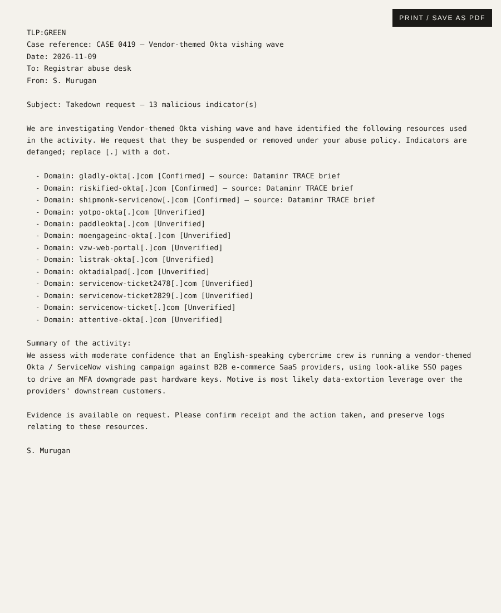

Generated by the request generator for the registrar abuse desk.

### The case brief

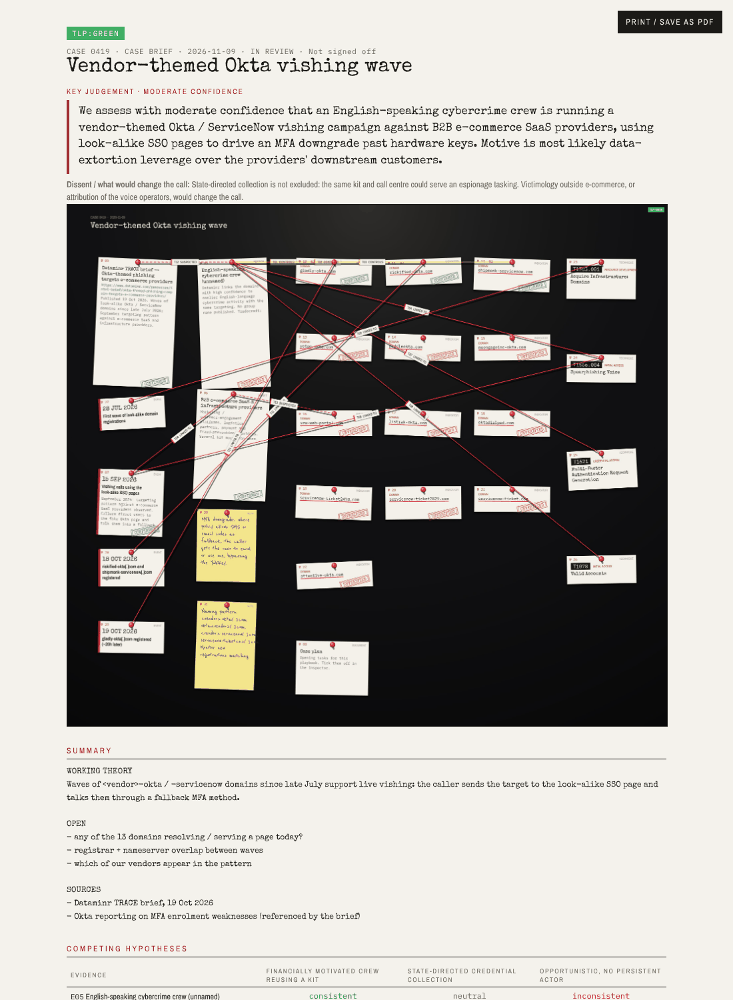

Printable brief for this case, as opened by "Case brief".

### The board as exported

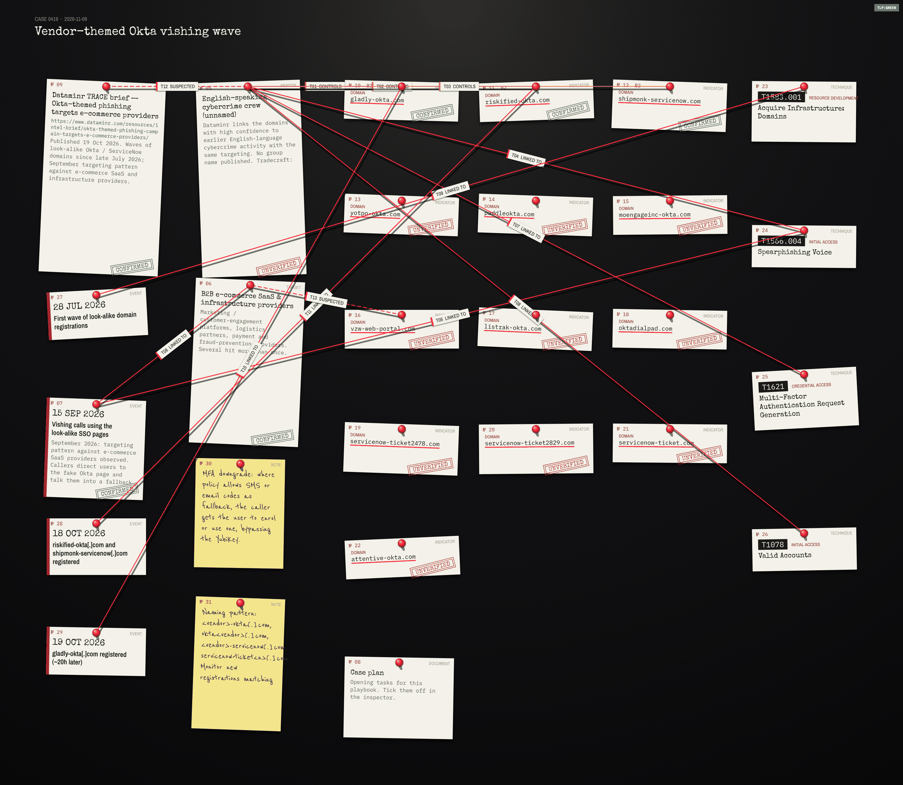

The PNG that "Export image" downloads for this case.

## Where the files end up

- `docs/exports/` holds the STIX 2.1 bundle and the case JSON produced at step 13. Import the JSON through **Import** to get this exact board back.
- Everything else lives in your browser's `localStorage` under the key `cyber-investigation-board.v1`. Use **Encrypt** in the case bar to protect it with a passphrase.

## Adapting this to your own case

1. Start from the template that matches the incident (phishing, crypto theft, ransomware, insider, impersonation) or a blank board.
2. Paste every report you receive into **Extract IOCs** rather than typing indicators by hand; defanged values are recognised.
3. Give every card a **source** and a **stamp** as you go; the **Audit** tab lists what is still missing.
4. Keep the **key judgement** current and save a **snapshot** before each briefing so you can show what changed.
5. Send the **case brief** or **one-pager** to people, and the **STIX** bundle to tools.
