# Version 2: sign-in, the case-files desk, and the board with a server behind it

The second design package added three pages around the board and a long list of board features. This document shows the whole thing running on the new backend (see `BACKEND.md`): accounts and roles, the desk, live sync between analysts, guest access, lockout, and the AI gateway without a key. Every screenshot was taken by `tools/capture/v2.cjs` against a freshly started server; the checks it asserts are listed at the end.

## Pages

| Page | URL | What it does |
| --- | --- | --- |
| Sign in | `/` | First run creates the administrator. Afterwards: name + password, forced password change after an admin reset, "Continue as a guest" when a public case exists, theme picker shared with the other pages. |
| Case files (the desk) | `/desk.html` | Every case the account may see as a manila folder: drawers by state (active, in review, published, archived), drag a folder onto a drawer to move it, flip for the key judgement and open tasks, needs-attention badges, red string between folders that share indicators, morning brief, evidence drop zone, quick add and OSINT hand-off, wastebasket with 30-day restore, colour tabs and tags, export / import, and the **Users & access** panel for admins. |
| Investigation board | `/board.html` | The board from version 1 plus: case modes (investigation, homicide, heist, missing person, KYC, fraud & AML, journalism, litigation, M&A, competitive intel, supply chain, HR/insider, genealogy, plot board, UX research, post-mortem, sales account map), the built-in Whitechapel 1888 worked example, Geo view on a Leaflet map, video / audio / PDF / email / code-log / live-feed / monitor / vehicle / object / statement cards, suspect matrix, court brief, hand-over pack (zip with manifest and hashes), walkthrough recording, radio, notifications, settings, thread styles and custom relations. |

## What the server changes for the user

- **Accounts are real.** Passwords are hashed with scrypt on the server, sessions are HttpOnly cookies that expire after 12 hours or 15 idle minutes, ten wrong passwords lock the account for 15 minutes, and every sign-in, failure and change is in a tamper-evident audit log.
- **Roles are enforced where it matters.** Admin, analyst, reviewer and viewer, with per-user case scope and a separate TLP:RED grant, are checked on every request. A viewer's edit is rejected by the server, not just hidden in the UI; a hidden case is a 404.
- **Cases live on the server.** The pages still read and write their local store, but it is filled from the server before render, every change is pushed per case with a revision, and other people's changes arrive over a live event stream. Two analysts can work on the same board.
- **OSINT works for more sources.** Hosts that refuse browser requests (crt.sh, urlscan, ThreatFox, URLhaus, MalwareBazaar, Wayback, Nominatim, Reddit, …) are fetched by the server through an allow-listed proxy with an SSRF guard; the third-party proxy the design used is gone.
- **The AI buttons work with any provider, or none.** "Analyse with Claude", translate, stance and entities go to the server's gateway, which tries the configured providers in order (Anthropic, OpenAI, Azure, Gemini, Cohere, Mistral, Groq, OpenRouter, DeepSeek, xAI, Together, Perplexity, Fireworks, Ollama, LM Studio, custom) and falls back to a built-in rule-based engine that labels its answers.
- **The board can research a case for you.** ◆ AI research gathers public sources (Wikipedia, world news, Hacker News, NVD/KEV, optional web search, pasted URLs), reads them on the server, and proposes attributed cards and threads to import into the inbox or onto the board. If you would rather run the prompt in Claude yourself, the panel copies a complete prompt and imports the pasted answer.
- **Media is kept.** Video, audio, PDF and image blobs are mirrored to a content-addressed file store, so a case opened on another machine still has its files.

## Walkthrough

### V01 · First-run setup

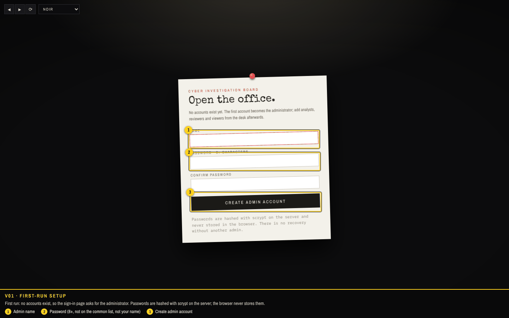

First run: no accounts exist, so the sign-in page asks for the administrator. Passwords are hashed with scrypt on the server; the browser never stores them.

1. Admin name
2. Password (8+, not on the common list, not your name)
3. Create admin account

### V02 · Case files desk

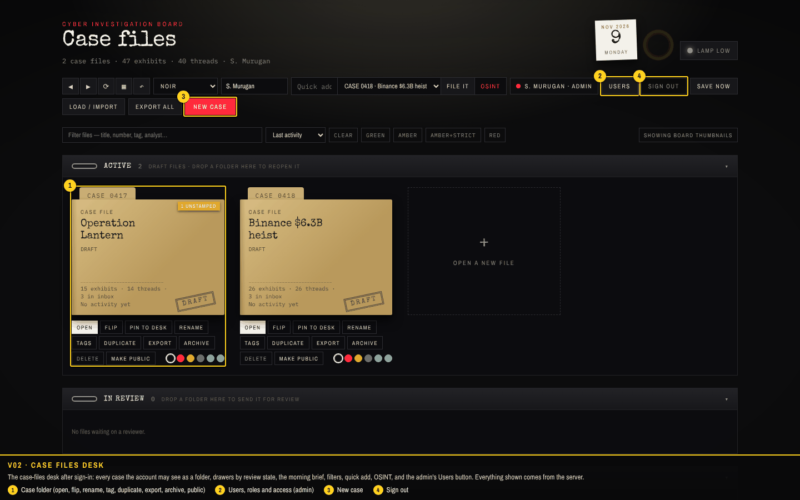

The case-files desk after sign-in: every case the account may see as a folder, drawers by review state, the morning brief, filters, quick add, OSINT, and the admin's Users button. Everything shown comes from the server.

1. Case folder (open, flip, rename, tag, duplicate, export, archive, public)
2. Users, roles and access (admin)
3. New case
4. Sign out

### V03 · Users and access

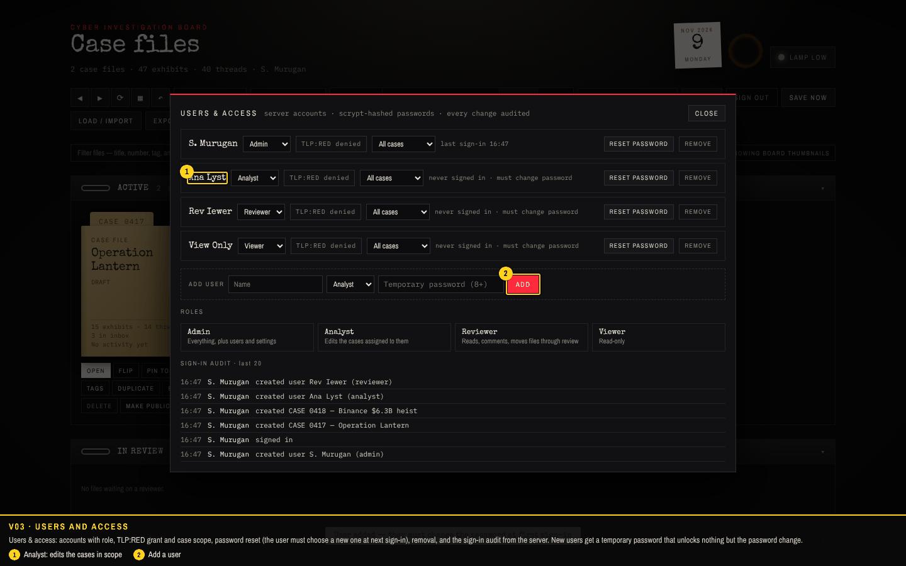

Users & access: accounts with role, TLP:RED grant and case scope, password reset (the user must choose a new one at next sign-in), removal, and the sign-in audit from the server. New users get a temporary password that unlocks nothing but the password change.

1. Analyst: edits the cases in scope
2. Add a user

### V04 · Analyst view

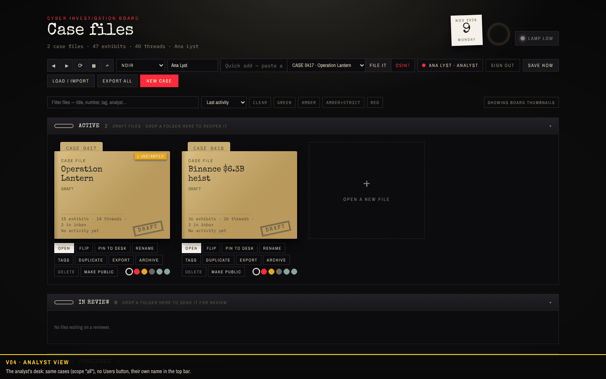

The analyst's desk: same cases (scope "all"), no Users button, their own name in the top bar.

### V05 · Board, modes and the worked example

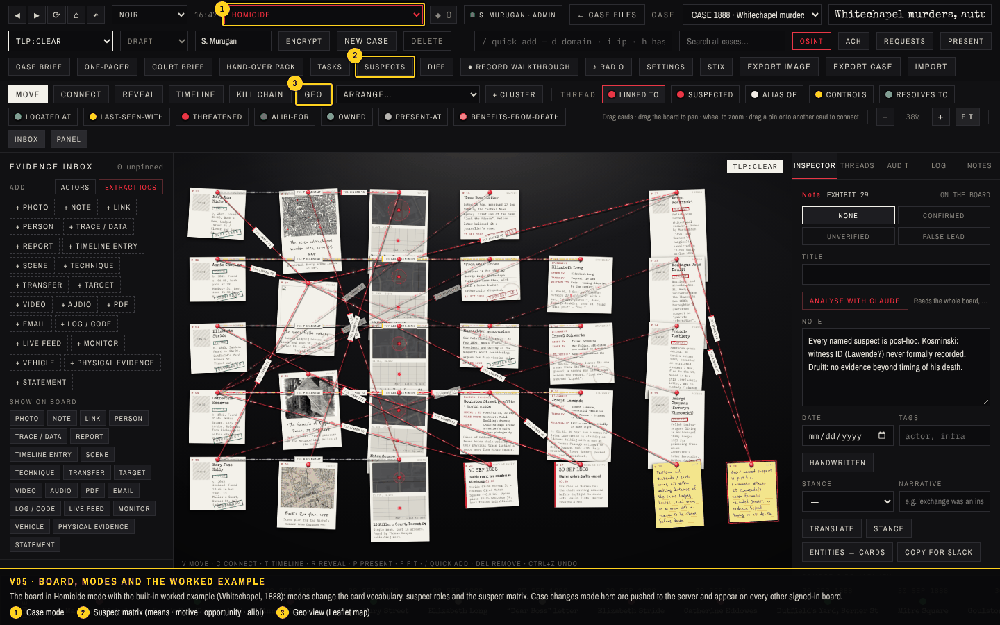

The board in Homicide mode with the built-in worked example (Whitechapel, 1888): modes change the card vocabulary, suspect roles and the suspect matrix. Case changes made here are pushed to the server and appear on every other signed-in board.

1. Case mode
2. Suspect matrix (means · motive · opportunity · alibi)
3. Geo view (Leaflet map)

### V06 · Geo view

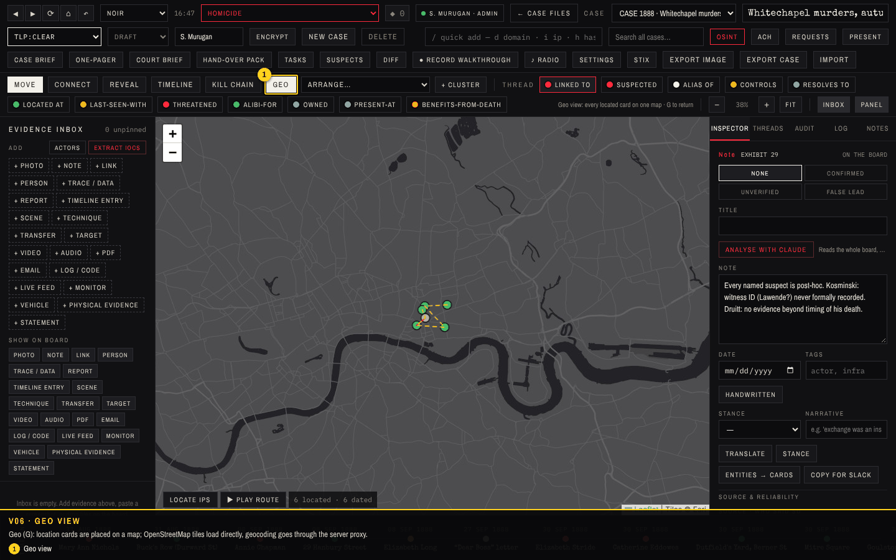

Geo (G): location cards are placed on a map; OpenStreetMap tiles load directly, geocoding goes through the server proxy.

1. Geo view

### V07 · Suspect matrix

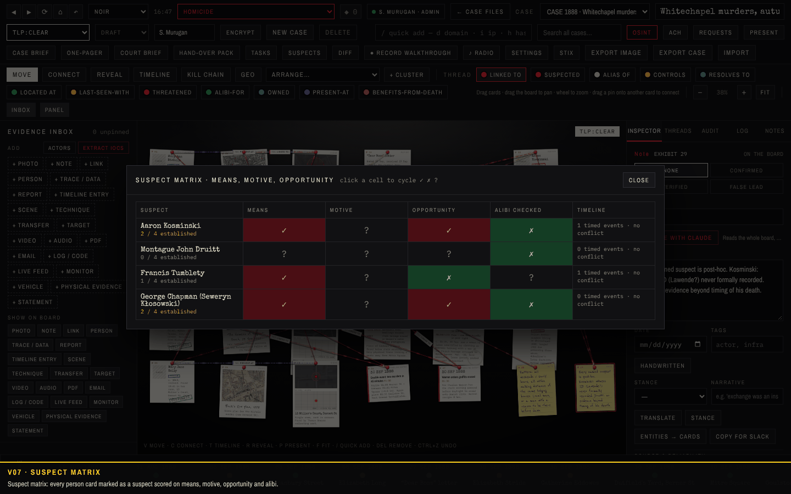

Suspect matrix: every person card marked as a suspect scored on means, motive, opportunity and alibi.

### V08 · AI gateway (local engine)

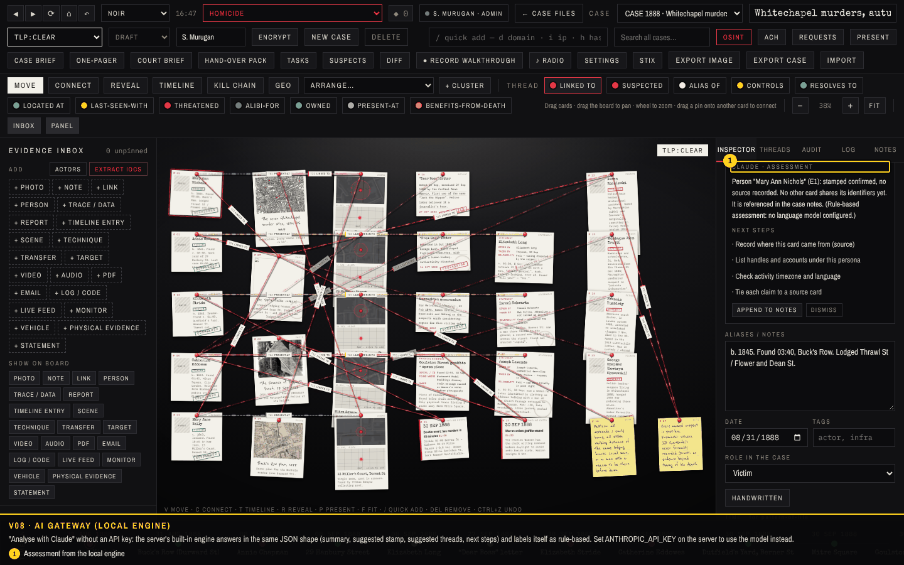

"Analyse with Claude" without an API key: the server's built-in engine answers in the same JSON shape (summary, suggested stamp, suggested threads, next steps) and labels itself as rule-based. Set ANTHROPIC_API_KEY on the server to use the model instead.

1. Assessment from the local engine

### V09 · Settings

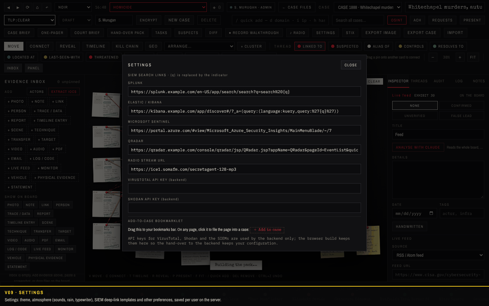

Settings: theme, atmosphere (sounds, rain, typewriter), SIEM deep-link templates and other preferences, saved per user on the server.

### V10 · Viewer

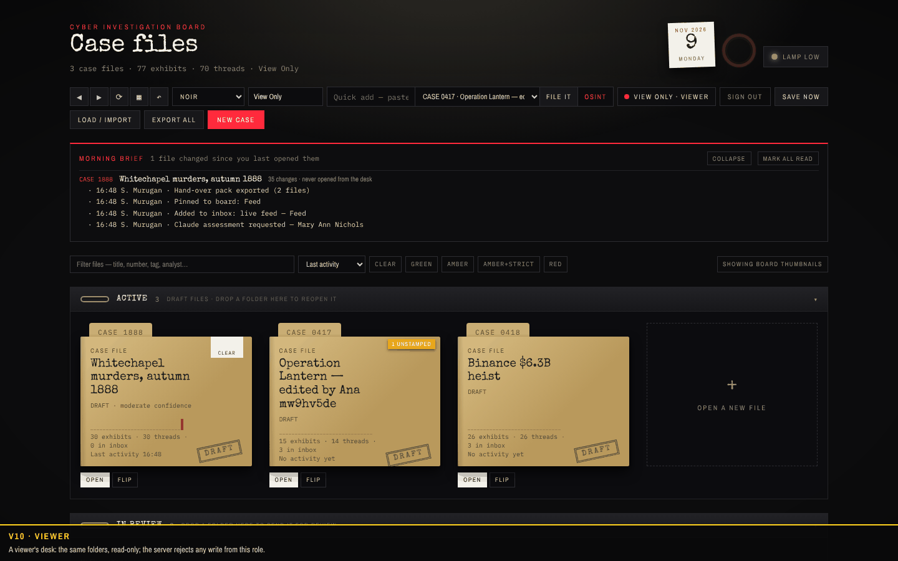

A viewer's desk: the same folders, read-only; the server rejects any write from this role.

### V11 · Guest

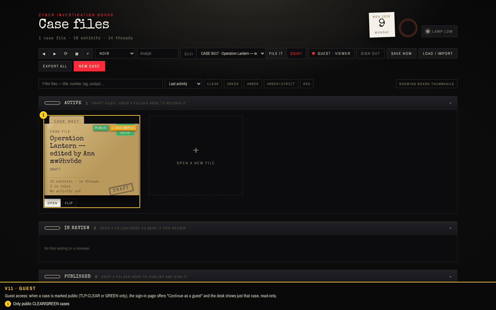

Guest access: when a case is marked public (TLP:CLEAR or GREEN only), the sign-in page offers "Continue as a guest" and the desk shows just that case, read-only.

1. Only public CLEAR/GREEN cases

### V12 · Lockout

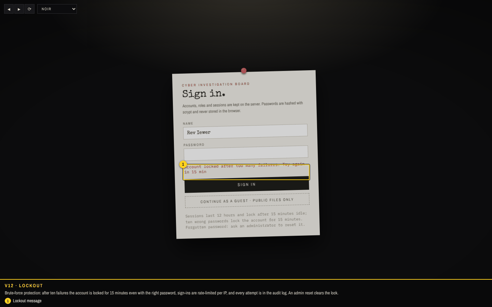

Brute-force protection: after ten failures the account is locked for 15 minutes even with the right password, sign-ins are rate-limited per IP, and every attempt is in the audit log. An admin reset clears the lock.

1. Lockout message

### V13 · Sign in

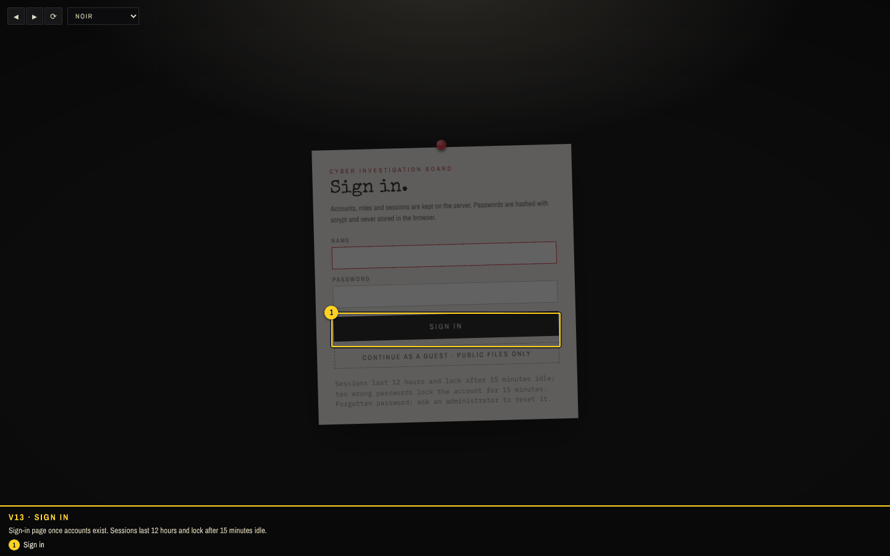

Sign-in page once accounts exist. Sessions last 12 hours and lock after 15 minutes idle.

1. Sign in

## Checks

**21 of 21 passed** in the run that produced these screenshots.

| Result | Check | Detail |
| --- | --- | --- |
| PASS | V01 first visit shows the setup card (no accounts yet) |  |
| PASS | V01 setup creates the admin and lands on the desk |  |
| PASS | V02 the board seeds the two sample cases on a brand-new server | CASE 0417 Operation Lantern \| CASE 0418 Binance $6.3B heist |
| PASS | V02 desk lists the cases from the server |  |
| PASS | V03 admin adds an analyst, a reviewer and a viewer from the desk | S. Murugan:admin, Ana Lyst:analyst, Rev Iewer:reviewer, View Only:viewer |
| PASS | V04 analyst signs in with the temporary password and must change it |  |
| PASS | V05 analyst edits a case on the board; the admin's open board receives it live | rev 2 delivered over SSE |
| PASS | V06 board: switch the case mode and seed the Whitechapel example | CASE 1888 Whitechapel murders, autumn 1888 · 29 items · mode homicide |
| PASS | V07 geo view renders a Leaflet map |  |
| PASS | V08 suspect matrix opens |  |
| PASS | V09 "Analyse with Claude" works without a model key (built-in engine) |  |
| PASS | V10 live feed card: ThreatFox through the server proxy | proxy reachable: HTTP 401 |
| PASS | V11 hand-over pack and court brief exports | CASE-1888-handover.zip |
| PASS | V12 settings panel (SIEM links, sounds, theme) |  |
| PASS | V13 viewer: read-only everywhere, no Users panel | rejected: read-only for your role |
| PASS | V14 TLP:RED cases stay hidden from accounts without the grant |  |
| PASS | V15 public case → guest can read it only |  |
| PASS | V16 ten wrong passwords lock the account for 15 minutes | Account locked after too many failures. Try again in 15 min |
| PASS | V17 audit chain verifies; health reports the engine | 28 audit rows, ai=local |
| PASS | V18 sign out invalidates the session |  |
| PASS | no unexpected page errors |  |
