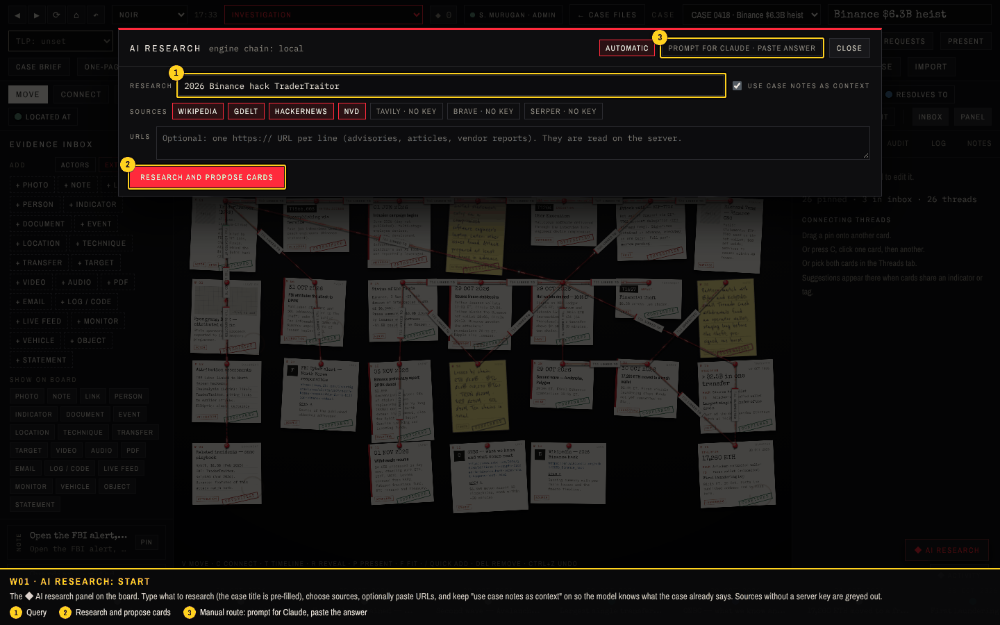
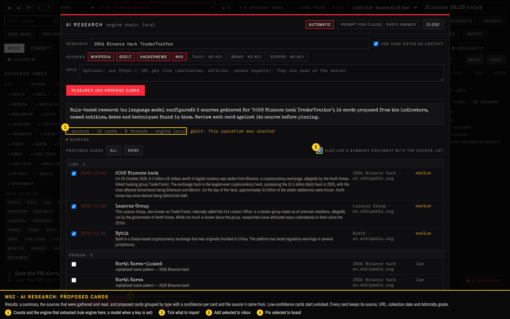
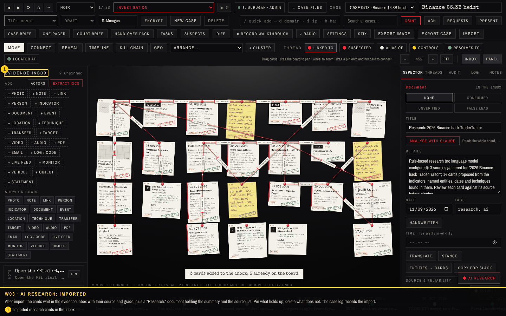
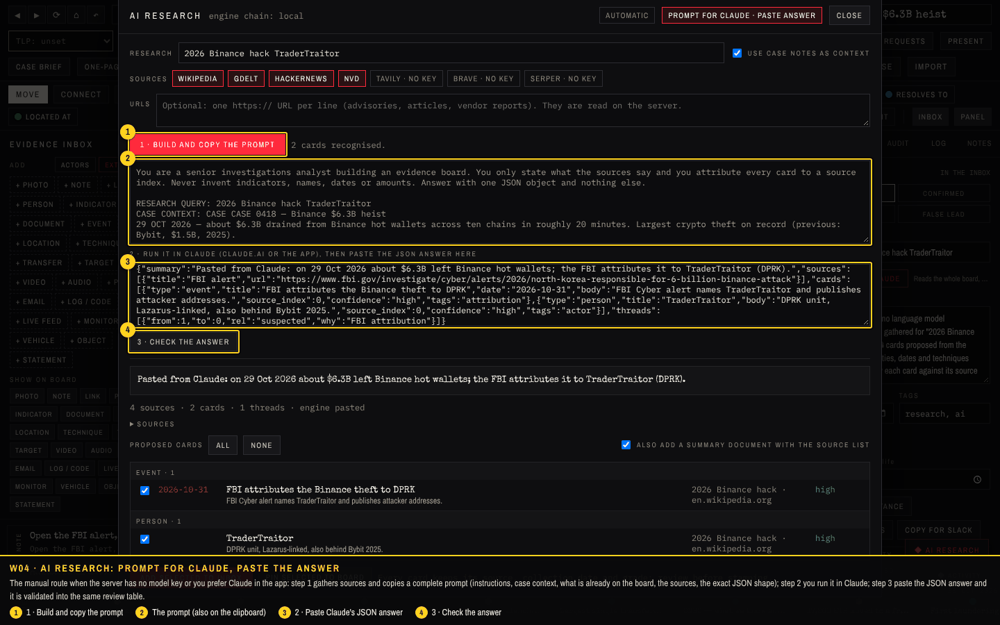
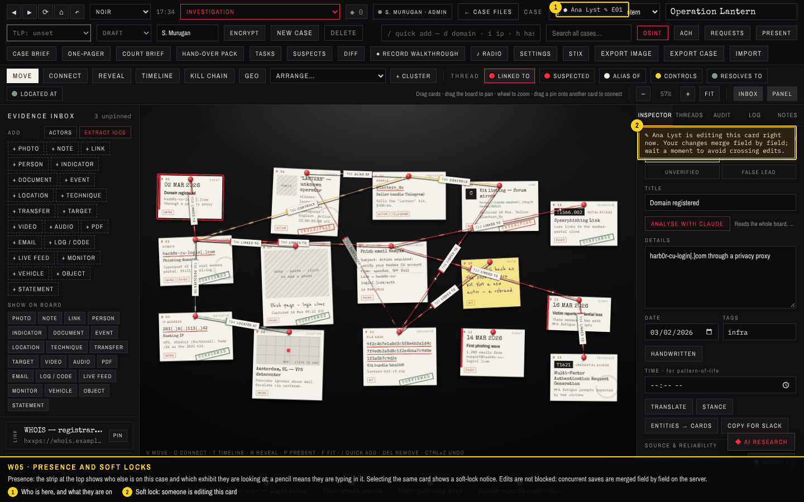
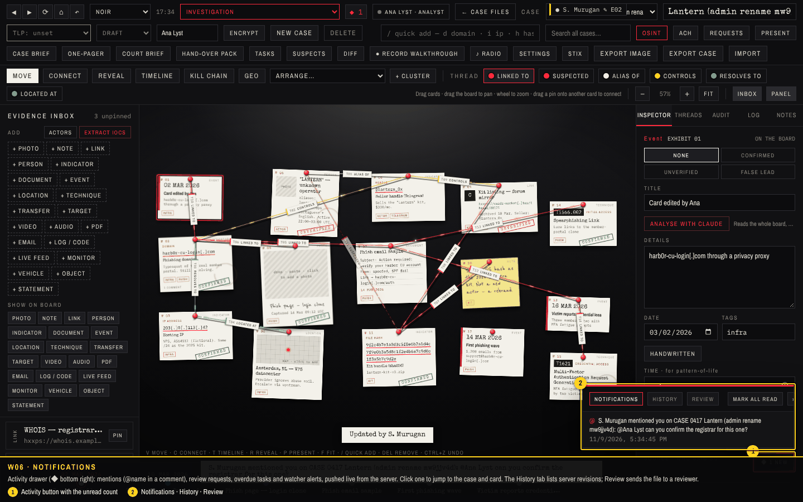
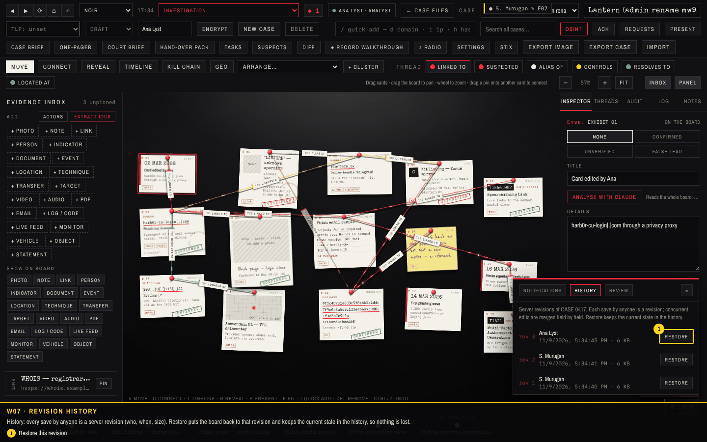
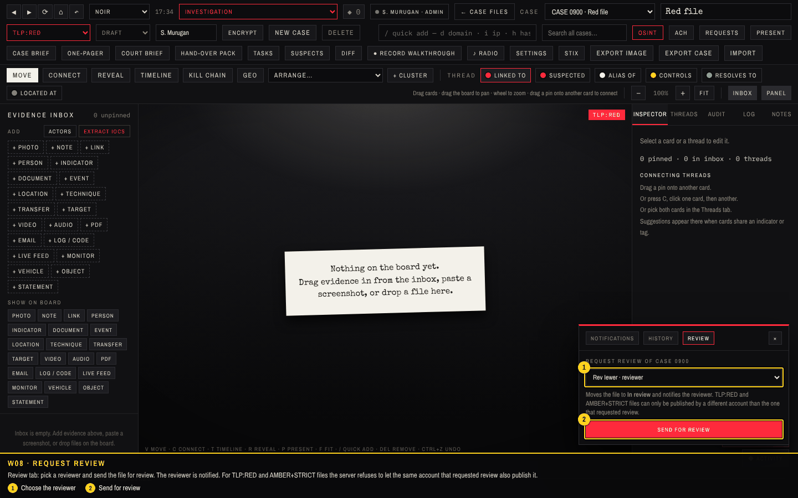

# Walkthrough 3: AI research, many model providers, and working together

This walkthrough covers what was added after the server: the **AI research** panel that turns a query into attributed cards (with a manual route through Claude), the **multi-provider AI gateway**, and the **collaboration** layer: presence and soft locks, merged concurrent edits, revision history with restore, @mention notifications, review requests and the second-account rule for TLP:RED files. Screenshots come from `tools/capture/v3.cjs` run against a fresh server; the checks it asserts are listed at the end.

## In short

| Feature | Where | What it does |
| --- | --- | --- |
| AI research | Board, ◆ AI research (Alt+A) | Gathers Wikipedia, GDELT news, Hacker News, NVD/KEV (and Tavily / Brave / Serper when keyed, plus pasted URLs), reads the pages on the server, proposes cards and threads with source, grade and confidence, imports what you tick into the inbox or onto the board. |
| Prompt for Claude, paste answer | Same panel, second tab | When the server has no model key: copies a complete prompt (instructions, case context, existing cards, sources, JSON shape) for Claude; the pasted answer is validated and imported the same way. |
| Model providers | Server environment | Anthropic, OpenAI, Azure OpenAI, Gemini, Cohere, Mistral, Groq, OpenRouter, DeepSeek, xAI, Together, Perplexity, Fireworks, Ollama, LM Studio, custom; tried in order with cooldown and cache; admins can list, test and disable them at runtime. The rule engine is the last resort. |
| Presence and soft locks | Board, top strip | Who is on the case, which exhibit they are on, who is typing in it; a notice when you select a card someone else is editing. |
| Merged edits | Server | A stale save is merged three ways against the revision the client started from: different fields and different cards from two analysts both survive; a deletion loses to a concurrent edit. |
| History | Activity drawer → History | Every save is a server revision; restore any of them, the current state stays in the history. |
| Notifications | Activity drawer | @mentions in comments, review requests, overdue tasks (hourly scan), watcher alerts; pushed live, with unread count; click to jump to the card. |
| Review requests and the TLP:RED rule | Activity drawer → Review | Send a file to a chosen reviewer; TLP:RED / AMBER+STRICT files must pass through review and be published by a different account than the requester. |

## Walkthrough

### W01 · AI research: start

The ◆ AI research panel on the board. Type what to research (the case title is pre-filled), choose sources, optionally paste URLs, and keep "use case notes as context" on so the model knows what the case already says. Sources without a server key are greyed out.

1. Query
2. Research and propose cards
3. Manual route: prompt for Claude, paste the answer

### W02 · AI research: proposed cards

Results: a summary, the sources that were gathered and read, and proposed cards grouped by type with a confidence per card and the source it came from. Low-confidence cards start unticked. Every card keeps its source, URL, collection date and Admiralty grade.

1. Counts and the engine that extracted (rule engine here; a model when a key is set)
2. Tick what to import
3. Add selected to inbox
4. Pin selected to board

### W03 · AI research: imported

After import: the cards wait in the evidence inbox with their source and grade, plus a "Research:" document holding the summary and the source list. Pin what holds up; delete what does not. The case log records the import.

1. Imported research cards in the inbox

### W04 · AI research: prompt for Claude, paste the answer

The manual route when the server has no model key or you prefer Claude in the app: step 1 gathers sources and copies a complete prompt (instructions, case context, what is already on the board, the sources, the exact JSON shape); step 2 you run it in Claude; step 3 paste the JSON answer and it is validated into the same review table.

1. 1 · Build and copy the prompt
2. The prompt (also on the clipboard)
3. 2 · Paste Claude's JSON answer
4. 3 · Check the answer

### W05 · Presence and soft locks

Presence: the strip at the top shows who else is on this case and which exhibit they are looking at; a pencil means they are typing in it. Selecting the same card shows a soft-lock notice. Edits are not blocked: concurrent saves are merged field by field on the server.

1. Who is here, and what they are on
2. Soft lock: someone is editing this card

### W06 · Notifications

Activity drawer (◆ bottom right): mentions (@name in a comment), review requests, overdue tasks and watcher alerts, pushed live from the server. Click one to jump to the case and card. The History tab lists server revisions; Review sends the file to a reviewer.

1. Activity button with the unread count
2. Notifications · History · Review

### W07 · Revision history

History: every save by anyone is a server revision (who, when, size). Restore puts the board back to that revision and keeps the current state in the history, so nothing is lost.

1. Restore this revision

### W08 · Request review

Review tab: pick a reviewer and send the file for review. The reviewer is notified. For TLP:RED and AMBER+STRICT files the server refuses to let the same account that requested review also publish it.

1. Choose the reviewer
2. Send for review

## Checks

**11 of 11 passed** in the run that produced these screenshots.

| Result | Check | Detail |
| --- | --- | --- |
| PASS | W01 setup admin, create analyst and reviewer |  |
| PASS | W02 the gateway reports its provider chain | local |
| PASS | W03 research panel: automatic research on the Binance case | 3 sources · 14 cards · 8 threads · engine local |
| PASS | W04 import the proposed cards into the inbox | items 29 -> 33 |
| PASS | W05 manual route: build the prompt, paste a Claude answer, import | prompt 4397 chars |
| PASS | W06 presence: two analysts on the same case see each other; editing a card shows a soft lock | ● Ana Lyst ✎ E01 |
| PASS | W07 concurrent edits on the same case are merged, not overwritten | rev 3, 2 revisions kept |
| PASS | W08 @mention in a comment notifies the named analyst | 1 unread for Ana |
| PASS | W09 history tab lists revisions and restores one | restored rev 1 → now rev 5 (Operation Lantern) |
| PASS | W10 TLP:RED: the requester cannot publish; a second account can | rejected: TLP:RED files need a second account to publish (you sent it for review) |
| PASS | no unexpected page errors |  |
