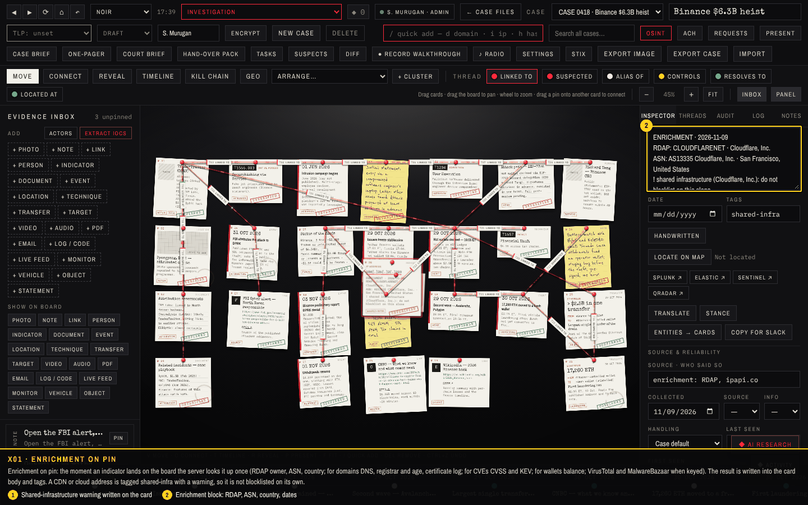
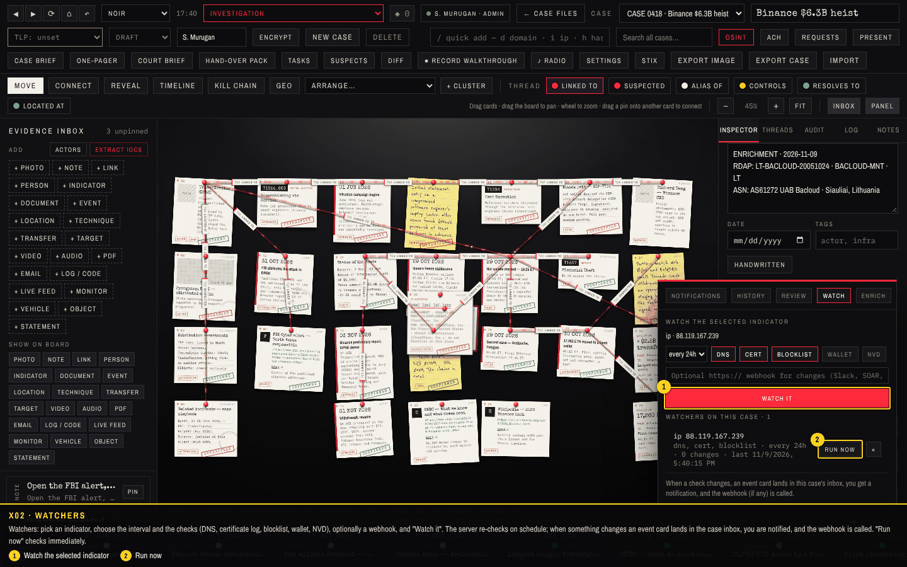
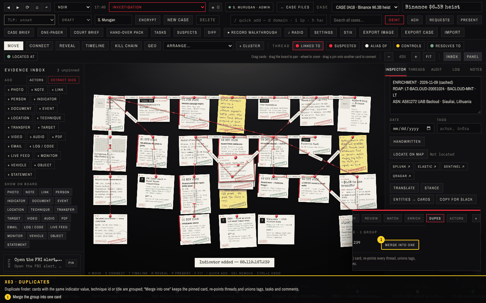
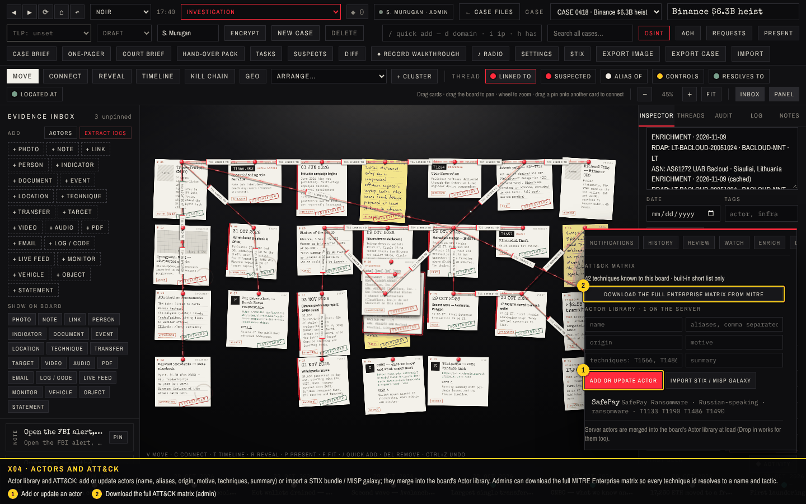
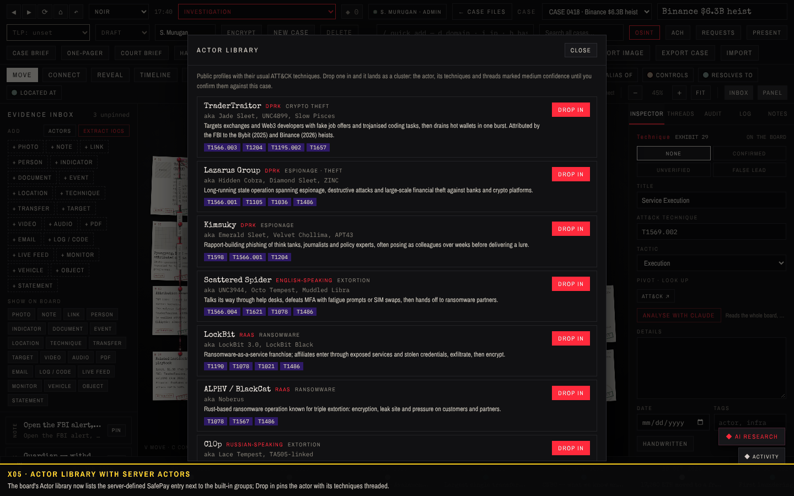

# Walkthrough 4: enrichment that runs itself

Indicators used to be looked up by hand, one at a time, in the OSINT workbench. This round makes the board do the routine work: every indicator is enriched when it is pinned, watchers re-check indicators on a schedule and raise the alarm when something changes, duplicates are found and merged in one click, and the technique and actor libraries can be as complete as MITRE's. Screenshots come from `tools/capture/v4.cjs` against a fresh server; the checks are listed at the end.

| Feature | Where | What it does |
| --- | --- | --- |
| Enrichment on pin | automatic; Activity drawer → Enrich | RDAP owner, ASN, country; DNS, registrar, domain age, certificate log; CVSS and CISA KEV; wallet balance; VirusTotal / MalwareBazaar when keyed. Written onto the card; 24 h server cache; `shared-infra` tag and warning for CDN, cloud and code-hosting ranges. "Enrich all pending" and "Refresh selected" for existing boards. |
| Watchers | Activity drawer → Watch | Per indicator: interval (1 h to 7 days), checks (DNS, certificate, blocklist, wallet, NVD), optional webhook. On change: event card in the case inbox, notification, webhook. "Run now" for an immediate check. |
| Duplicate finder | Activity drawer → Dupes | Same indicator value, technique id or title grouped; merge into one keeps the pinned card, re-points threads, unions tags, tasks, comments. |
| ATT&CK matrix | Activity drawer → Actors (admin) | Downloads the full MITRE Enterprise matrix once; every `T-id` typed into quick add then resolves to its name and tactic, and the kill-chain view lanes it. |
| Actor library | Activity drawer → Actors | Add or update actors, import STIX intrusion sets / threat actors or a MISP galaxy; merged into the board's Actor library (Drop in works for them). |

## Walkthrough

### X01 · Enrichment on pin

Enrichment on pin: the moment an indicator lands on the board the server looks it up once (RDAP owner, ASN, country; for domains DNS, registrar and age, certificate log; for CVEs CVSS and KEV; for wallets balance; VirusTotal and MalwareBazaar when keyed). The result is written into the card body and tags. A CDN or cloud address is tagged shared-infra with a warning, so it is not blocklisted on its own.

1. Shared-infrastructure warning written on the card
2. Enrichment block: RDAP, ASN, country, dates

### X02 · Watchers

Watchers: pick an indicator, choose the interval and the checks (DNS, certificate log, blocklist, wallet, NVD), optionally a webhook, and "Watch it". The server re-checks on schedule; when something changes an event card lands in the case inbox, you are notified, and the webhook is called. "Run now" checks immediately.

1. Watch the selected indicator
2. Run now

### X03 · Duplicates

Duplicate finder: cards with the same indicator value, technique id or title are grouped; "Merge into one" keeps the pinned card, re-points threads and unions tags, tasks and comments.

1. Merge the group into one card

### X04 · Actors and ATT&CK

Actor library and ATT&CK: add or update actors (name, aliases, origin, motive, techniques, summary) or import a STIX bundle / MISP galaxy; they merge into the board's Actor library. Admins can download the full MITRE Enterprise matrix so every technique id resolves to a name and tactic.

1. Add or update an actor
2. Download the full ATT&CK matrix (admin)

### X05 · Actor library with server actors

The board's Actor library now lists the server-defined SafePay entry next to the built-in groups; Drop in pins the actor with its techniques threaded.

## Checks

**8 of 8 passed** in the run that produced these screenshots.

| Result | Check | Detail |
| --- | --- | --- |
| PASS | X01 setup and open the board | ATT&CK techniques known at start: 42 |
| PASS | X02 enrichment on pin: a quick-added IP gets RDAP/ASN written onto the card; a Cloudflare IP is flagged shared | ASN AS61272 UAB Bacloud · Cloudflare tagged shared-infra |
| PASS | X03 watcher: watch the C2 IP, run it now, see it in the list | ip 88.119.167.239 every 24h (dns, cert, blocklist) |
| PASS | X04 duplicate finder merges two cards for the same indicator | merged to one card |
| PASS | X05 actor library: add an actor on the server; it is available to the board's Drop in after reload | 1 actor(s) on the server |
| PASS | X06 full ATT&CK matrix download from MITRE (needs internet; skipped gracefully if blocked) | 706 techniques (ATT&CK ); T1569.002 → Service Execution |
| PASS | X07 drop in a server-defined actor from the Actor library |  |
| PASS | no unexpected page errors |  |
