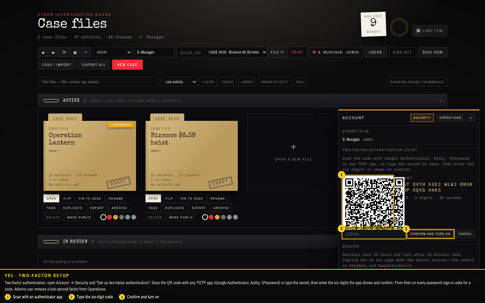
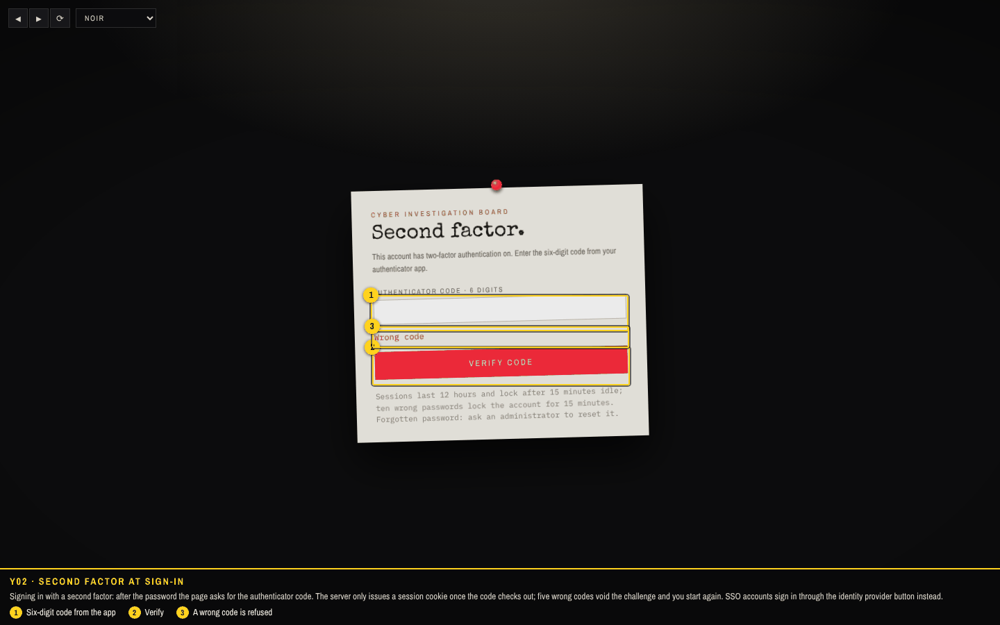
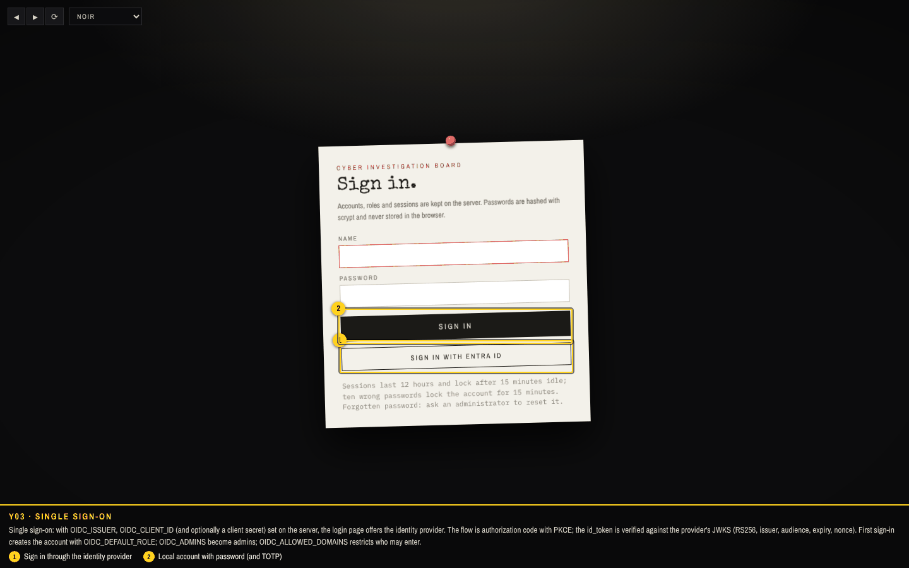
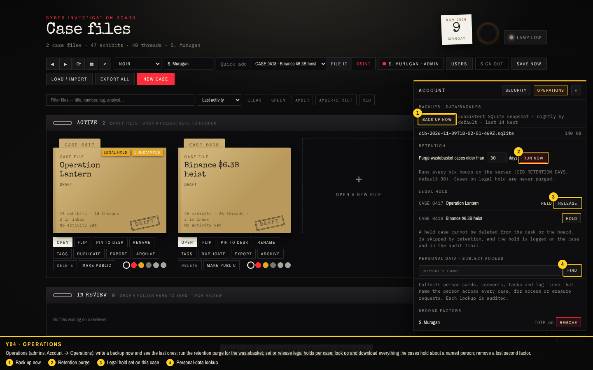
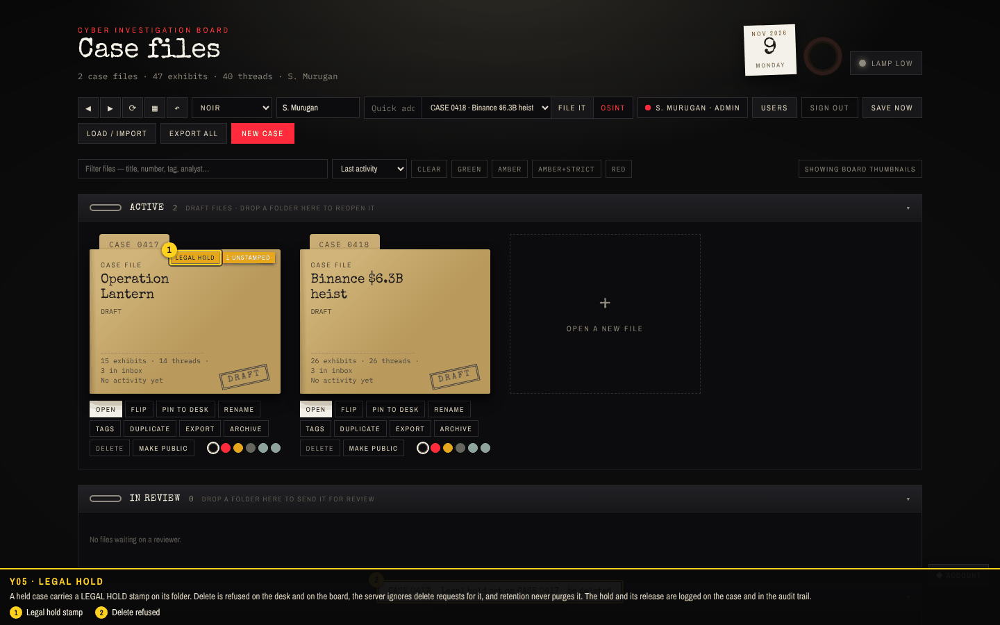
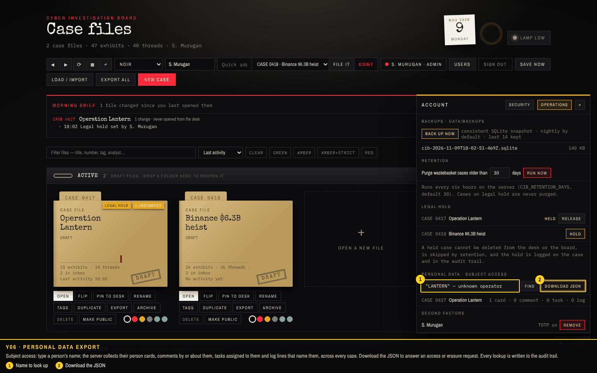
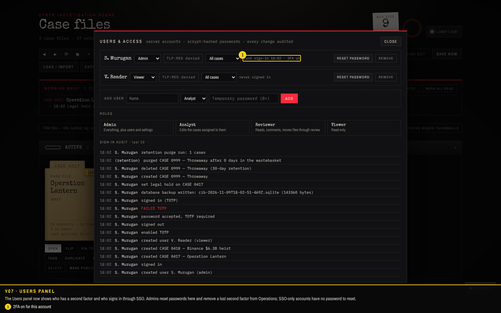

# Walkthrough 5: security and operations

This round hardens accounts and makes the server something you can run for years: a second factor for local accounts, single sign-on through any OIDC provider, files that inherit their case's TLP, legal holds that no delete or purge can cross, retention that cleans the wastebasket on its own, consistent backups, a personal-data export for access and erasure requests, and a one-command deployment behind TLS. Screenshots come from `tools/capture/v5.cjs` against a fresh server started with an OIDC provider configured; the checks are listed at the end.

| Feature | Where | What it does |
| --- | --- | --- |
| Two-factor authentication | Account → Security (every user) | TOTP (RFC 6238, SHA-1, 6 digits, 30 s): QR code and secret, confirm with a code, then every password sign-in asks for a code. Single-use five-minute challenges; five wrong codes void the challenge. Turn off with your password; admins remove a lost factor from Operations. |
| Single sign-on | login page, when `OIDC_ISSUER` + `OIDC_CLIENT_ID` are set | Authorization code with PKCE and nonce; discovery from the issuer; RS256 id_token verified against the provider's JWKS (issuer, audience, expiry, nonce). First sign-in creates the account with `OIDC_DEFAULT_ROLE`; `OIDC_ADMINS` become admins; `OIDC_ALLOWED_DOMAINS` limits entry. SSO accounts have no password. |
| Per-file access | automatic | Uploads carry the case id; the server refuses uploads into cases you cannot edit and serves a file only to people who may see its case (TLP:RED grant, case scope, public flag). |
| Legal hold | Account → Operations (admin) | Stamped on the folder; delete refused on desk and board; the server ignores delete requests; retention skips it; set and release are logged on the case and audited. Only admins can change it, including through the sync API. |
| Retention | automatic + Operations | Wastebasket cases are hard-deleted after `CIB_RETENTION_DAYS` (30) every six hours; "Run now" with a chosen window. |
| Backups | Operations, `npm run backup`, `CIB_BACKUP_HOURS` | `VACUUM INTO` snapshot under `data/backups`, pruned to `CIB_BACKUPS_KEEP` (14). Files live content-addressed under `data/files` and can be rsynced. |
| Personal data | Operations | Person cards, comments, tasks and log lines naming a person across every case; download as JSON; each lookup audited. |
| Deployment | `Dockerfile`, `docker-compose.yml`, `deploy/Caddyfile`, `.env.example` | Multi-stage image (pages built, server runs as a non-root user with a health check); Caddy terminates TLS with automatic certificates for `CIB_DOMAIN`; secure cookies and proxy trust switched on. |

## How to turn it on

1. **Second factor**: sign in, open **Account** (bottom right) → **Security** → *Set up two-factor authentication*. Scan, type the six digits, *Confirm and turn on*.
2. **Single sign-on**: register the redirect URI `https://<host>/api/auth/oidc/callback` with your provider, then set `OIDC_ISSUER`, `OIDC_CLIENT_ID` (and `OIDC_CLIENT_SECRET` for confidential clients) in `.env`. Optional: `OIDC_LABEL`, `OIDC_DEFAULT_ROLE`, `OIDC_ADMINS`, `OIDC_ALLOWED_DOMAINS`.
3. **Deploy**: `cp .env.example .env`, set `CIB_DOMAIN`, `docker compose up -d`. The first visit creates the admin account. (This capture checks the files exist; the image build was not run on the capture machine.)
4. **Operations**: as an admin open **Account → Operations** for backups, retention, legal holds, personal-data lookups and second-factor resets.

### Y01 · Two-factor setup

Two-factor authentication: open Account → Security and "Set up two-factor authentication". Scan the QR code with any TOTP app (Google Authenticator, Authy, 1Password) or type the secret, then enter the six digits the app shows and confirm. From then on every password sign-in asks for a code. Admins can remove a lost second factor from Operations.

1. Scan with an authenticator app
2. Type the six-digit code
3. Confirm and turn on

### Y02 · Second factor at sign-in

Signing in with a second factor: after the password the page asks for the authenticator code. The server only issues a session cookie once the code checks out; five wrong codes void the challenge and you start again. SSO accounts sign in through the identity provider button instead.

1. Six-digit code from the app
2. Verify
3. A wrong code is refused

### Y03 · Single sign-on

Single sign-on: with OIDC_ISSUER, OIDC_CLIENT_ID (and optionally a client secret) set on the server, the login page offers the identity provider. The flow is authorization code with PKCE; the id_token is verified against the provider's JWKS (RS256, issuer, audience, expiry, nonce). First sign-in creates the account with OIDC_DEFAULT_ROLE; OIDC_ADMINS become admins; OIDC_ALLOWED_DOMAINS restricts who may enter.

1. Sign in through the identity provider
2. Local account with password (and TOTP)

### Y04 · Operations

Operations (admins, Account → Operations): write a backup now and see the last ones; run the retention purge for the wastebasket; set or release legal holds per case; look up and download everything the cases hold about a named person; remove a lost second factor.

1. Back up now
2. Retention purge
3. Legal hold set on this case
4. Personal-data lookup

### Y05 · Legal hold

A held case carries a LEGAL HOLD stamp on its folder. Delete is refused on the desk and on the board, the server ignores delete requests for it, and retention never purges it. The hold and its release are logged on the case and in the audit trail.

1. Legal hold stamp
2. Delete refused

### Y06 · Personal data export

Subject access: type a person's name; the server collects their person cards, comments by or about them, tasks assigned to them and log lines that name them, across every case. Download the JSON to answer an access or erasure request. Every lookup is written to the audit trail.

1. Name to look up
2. Download the JSON

### Y07 · Users panel

The Users panel now shows who has a second factor and who signs in through SSO. Admins reset passwords here and remove a lost second factor from Operations; SSO-only accounts have no password to reset.

1. 2FA on for this account

## Checks

**12 of 12 passed** in the run that produced these screenshots.

| Result | Check | Detail |
| --- | --- | --- |
| PASS | Y01 setup: first admin, sample case, a viewer account | 2 case(s) seeded · viewer created |
| PASS | Y02 two-factor setup from Account → Security: QR and secret shown, code confirmed | secret 32 chars · enabled |
| PASS | Y03 sign-in now has a second step: password, then the authenticator code; a wrong code is refused | session issued after the right code |
| PASS | Y04 single sign-on button appears when an OIDC provider is configured | button "Sign in with Entra ID" → /api/auth/oidc/start |
| PASS | Y05 operations: back up now writes a SQLite snapshot and lists it | cib-2026-11-09T18-02-51-469Z.sqlite · 143360 bytes |
| PASS | Y06 legal hold: set from Operations, stamped on the folder, delete refused | case kept; stamp shown; delete refused |
| PASS | Y07 retention: a deleted case is purged on demand; held cases are skipped | 1 purged · held case kept |
| PASS | Y08 personal data: find everything about a named person across cases and download it | ""LANTERN" — unknown operator" in 1 case(s) |
| PASS | Y09 per-file access: a photo in a TLP:RED case is not served to a viewer without the grant | viewer → 404 · admin → 200 |
| PASS | Y10 users panel shows second factors and SSO per account |  |
| PASS | Y11 deployment files: Dockerfile, compose with Caddy TLS, env example, backup script | present (docker build itself is not run by this capture) |
| PASS | no unexpected page errors |  |
