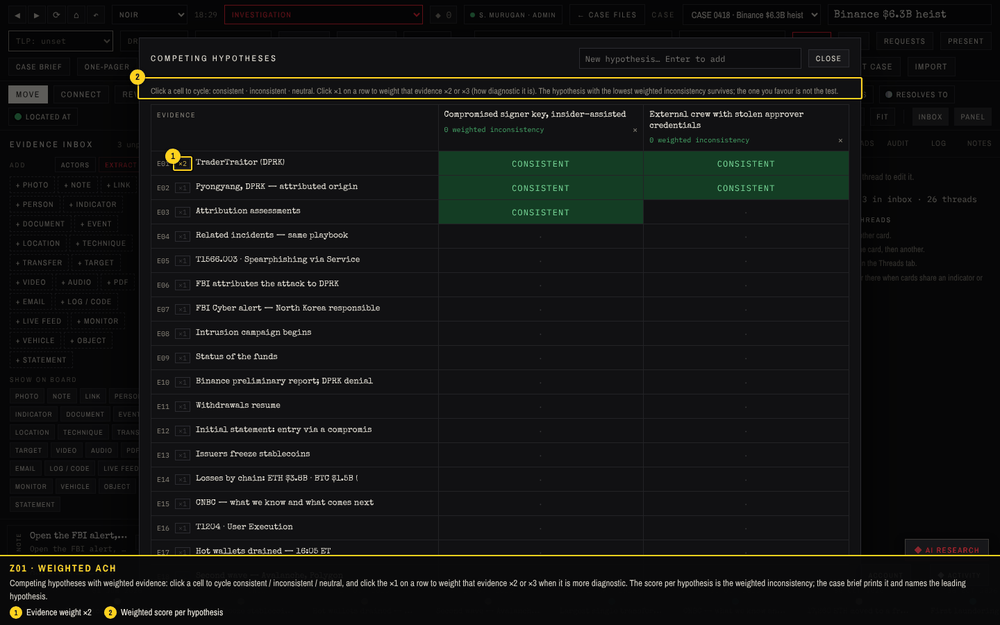
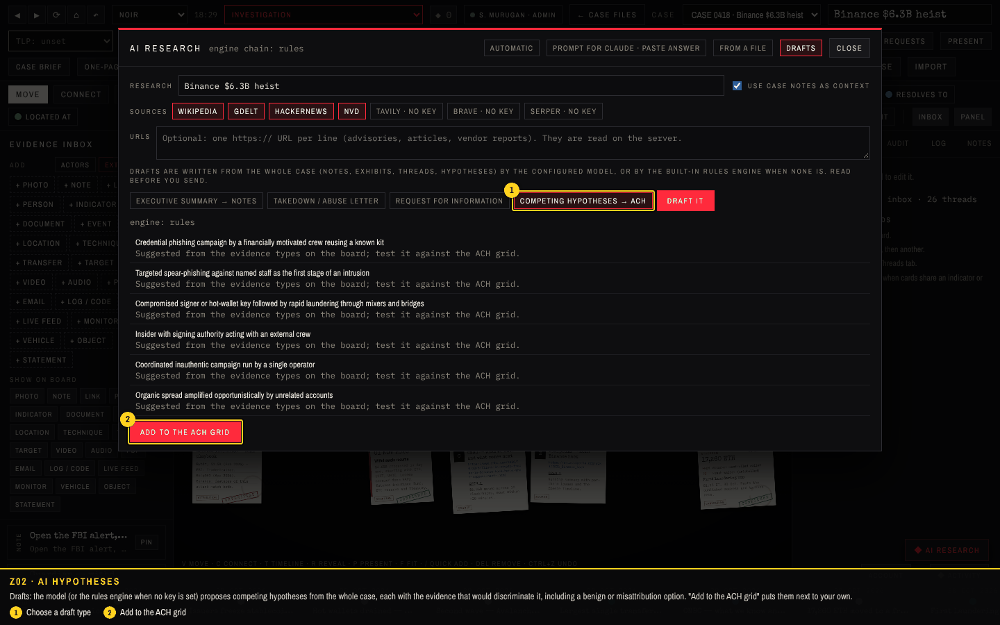
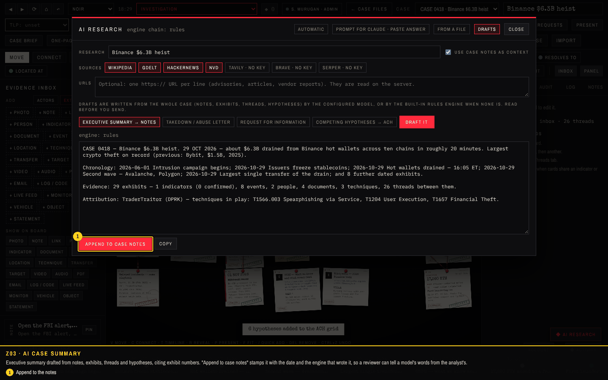
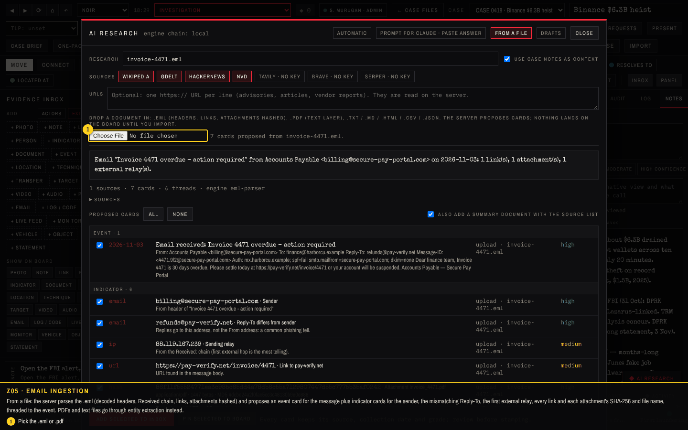
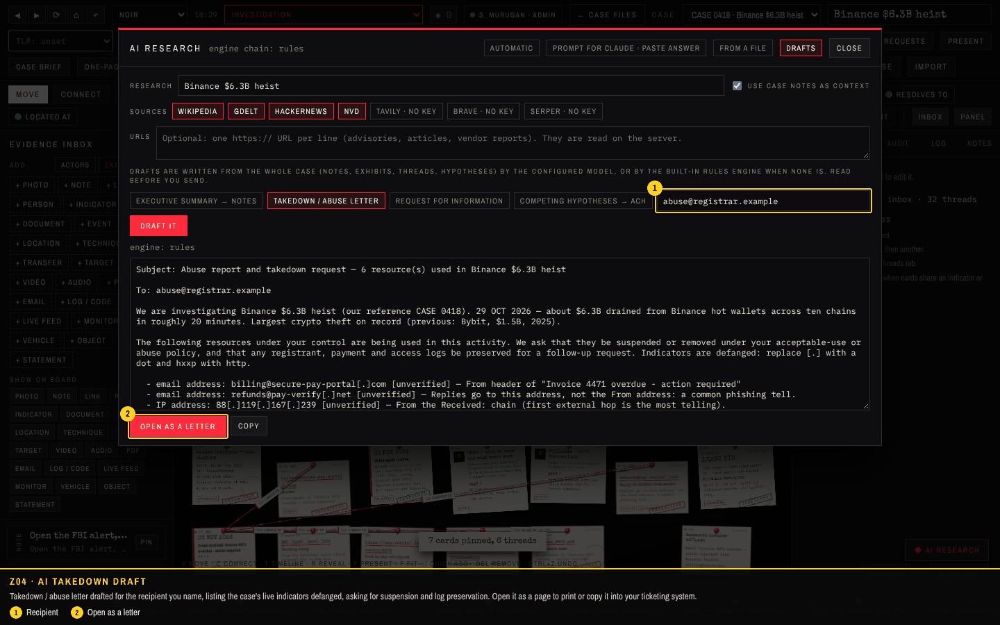
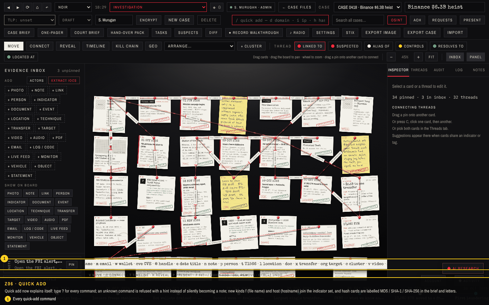
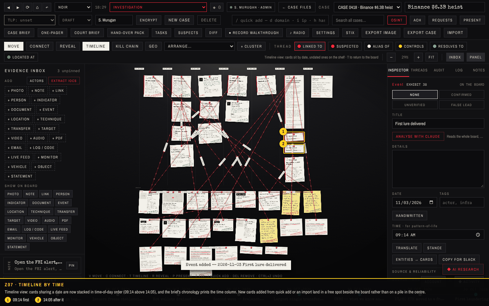
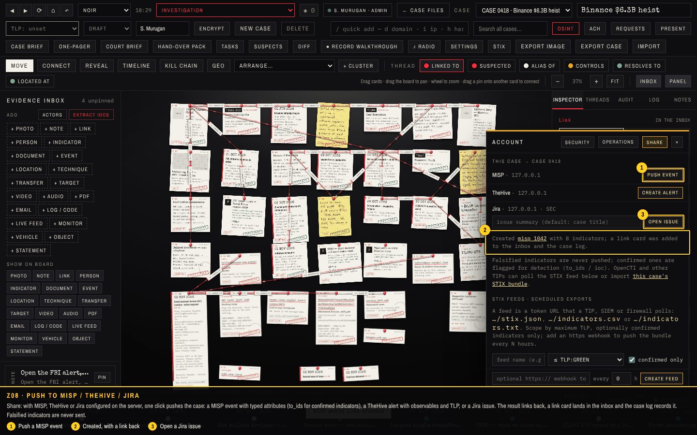
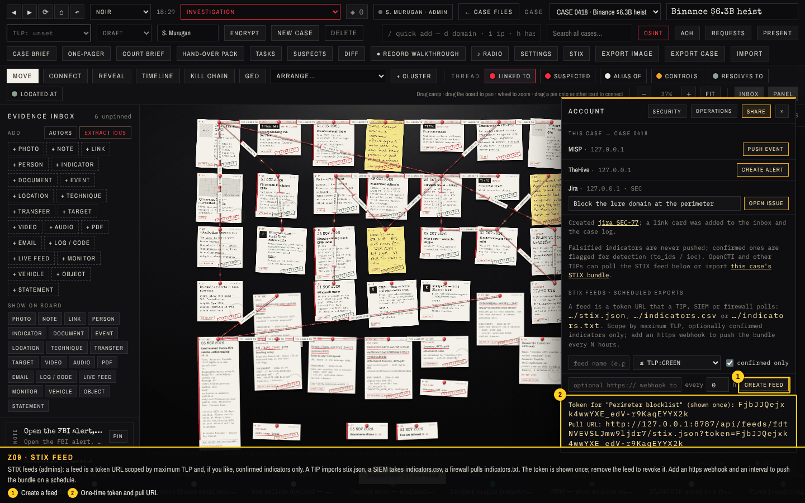
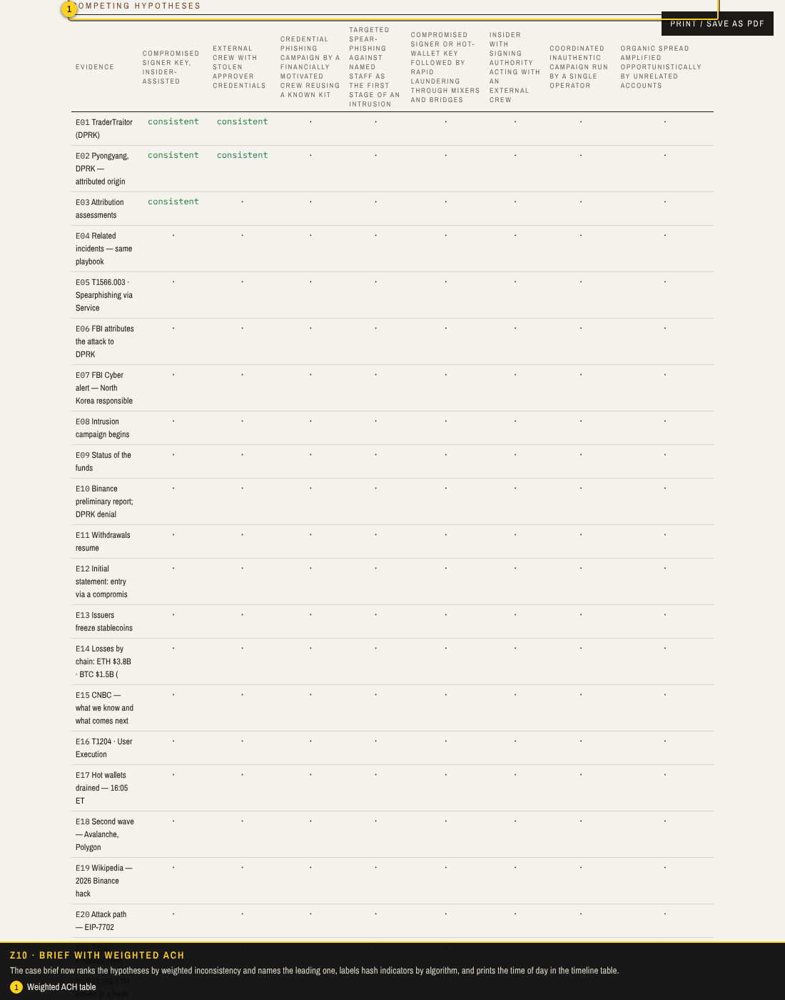

# Walkthrough 6: reporting, integrations and AI beyond the buttons

The last round of the roadmap takes the case out of the board and brings documents in. Cases push to MISP, TheHive and Jira in one click; token-protected STIX feeds let a TIP, SIEM or firewall poll the indicators on a schedule; emails and PDFs become proposed cards; the model (or the rules engine when there is none) drafts the executive summary, the takedown letter and the competing hypotheses from the whole case; the analysis-of-competing-hypotheses grid gains evidence weights that the brief prints; the timeline orders a day by time; and the small irritations noted in `docs/IMPROVEMENTS.md` are fixed. Screenshots come from `tools/capture/v6.cjs` against a fresh server with a stand-in MISP/TheHive/Jira (`tools/capture/mock-tip.cjs`); the checks are listed at the end.

| Feature | Where | What it does |
| --- | --- | --- |
| Push to MISP / TheHive / Jira | Account → Share | MISP event with typed attributes (`to_ids` for confirmed), TheHive alert with observables and TLP, Jira issue with the case reference. A link card and a log line are added to the case. Keys live in the server environment. |
| STIX feeds | Account → Share (admin) | Token URLs serving a STIX 2.1 bundle, CSV or plain indicator list, scoped by maximum TLP and confirmed-only, with pull counts; optional https webhook push every N hours. Per-case bundle at `/api/store/case/:id/stix.json`. |
| Documents in | AI research → From a file | `.eml`: event card plus sender, reply-to mismatch, first external relay, links, attachments (SHA-256 and file name) with threads between them. `.pdf` and text: entity and indicator extraction, with the model when one is configured. Nothing lands until you import. |
| AI drafts | AI research → Drafts | Executive summary appended to the notes; takedown or RFI letter opened as a page; competing hypotheses added to the ACH grid. Every draft cites exhibits and is logged with the engine that wrote it. |
| ACH weights | ACH grid, Case brief | Click ×1 on a row to weight that evidence ×2 or ×3. Scores become weighted inconsistency; the brief prints them and names the leading hypothesis. |
| Timeline time of day | Timeline view, brief | Cards on the same day are ordered by their time; the chronology table prints it. |
| Quick add | board | `f file.exe` and `host name` kinds, `?` lists every command, unknown commands are refused instead of becoming notes, hash cards say MD5 / SHA-1 / SHA-256 in the brief and letters. |
| Placement and Esc | board | New pinned cards land in a free spot next to the board instead of a pile in the centre; Esc closes a panel even while the cursor is in a text box. |

## How to use it

1. **Share a case**: open the case on the board, **Account → Share**. Buttons appear for each system configured on the server (`MISP_URL`/`MISP_KEY`, `THEHIVE_URL`/`THEHIVE_KEY`, `JIRA_URL`/`JIRA_EMAIL`/`JIRA_TOKEN`/`JIRA_PROJECT`). Falsified indicators are never sent.
2. **Feed a firewall or TIP**: as admin, create a feed in the same tab, copy the one-time token, and point the consumer at `…/indicators.txt?token=…` (or `.csv`, or `stix.json`). Remove the feed to revoke.
3. **Bring a document in**: **AI research → From a file**, pick the `.eml` or `.pdf`, review the proposals, untick what you do not want, import to the inbox or straight to the board.
4. **Let the model write**: **AI research → Drafts**, choose Summary, Takedown, RFI or Hypotheses, *Draft it*, read, then apply. With no model key the rules engine writes a plain but factual version from the case.

### Z01 · Weighted ACH

Competing hypotheses with weighted evidence: click a cell to cycle consistent / inconsistent / neutral, and click the ×1 on a row to weight that evidence ×2 or ×3 when it is more diagnostic. The score per hypothesis is the weighted inconsistency; the case brief prints it and names the leading hypothesis.

1. Evidence weight ×2
2. Weighted score per hypothesis

### Z02 · AI hypotheses

Drafts: the model (or the rules engine when no key is set) proposes competing hypotheses from the whole case, each with the evidence that would discriminate it, including a benign or misattribution option. "Add to the ACH grid" puts them next to your own.

1. Choose a draft type
2. Add to the ACH grid

### Z03 · AI case summary

Executive summary drafted from notes, exhibits, threads and hypotheses, citing exhibit numbers. "Append to case notes" stamps it with the date and the engine that wrote it, so a reviewer can tell a model's words from the analyst's.

1. Append to the notes

### Z05 · Email ingestion

From a file: the server parses the .eml (decoded headers, Received chain, links, attachments hashed) and proposes an event card for the message plus indicator cards for the sender, the mismatching Reply-To, the first external relay, every link and each attachment's SHA-256 and file name, threaded to the event. PDFs and text files go through entity extraction instead.

1. Pick the .eml or .pdf

### Z04 · AI takedown draft

Takedown / abuse letter drafted for the recipient you name, listing the case's live indicators defanged, asking for suspension and log preservation. Open it as a page to print or copy it into your ticketing system.

1. Recipient
2. Open as a letter

### Z06 · Quick add

Quick add now explains itself: type ? for every command; an unknown command is refused with a hint instead of silently becoming a note; new kinds f (file name) and host (hostname) join the indicator set, and hash cards are labelled MD5 / SHA-1 / SHA-256 in the brief and letters.

1. Every quick-add command

### Z07 · Timeline by time

Timeline view: cards sharing a date are now stacked in time-of-day order (09:14 above 14:05), and the brief's chronology prints the time column. New cards added from quick add or an import land in a free spot beside the board rather than on a pile in the centre.

1. 09:14 first
2. 14:05 after it

### Z08 · Push to MISP / TheHive / Jira

Share: with MISP, TheHive or Jira configured on the server, one click pushes the case: a MISP event with typed attributes (to_ids for confirmed indicators), a TheHive alert with observables and TLP, or a Jira issue. The result links back, a link card lands in the inbox and the case log records it. Falsified indicators are never sent.

1. Push a MISP event
2. Created, with a link back
3. Open a Jira issue

### Z09 · STIX feed

STIX feeds (admins): a feed is a token URL scoped by maximum TLP and, if you like, confirmed indicators only. A TIP imports stix.json, a SIEM takes indicators.csv, a firewall pulls indicators.txt. The token is shown once; remove the feed to revoke it. Add an https webhook and an interval to push the bundle on a schedule.

1. Create a feed
2. One-time token and pull URL

### Z10 · Brief with weighted ACH

The case brief now ranks the hypotheses by weighted inconsistency and names the leading one, labels hash indicators by algorithm, and prints the time of day in the timeline table.

1. Weighted ACH table

## Checks

**13 of 13 passed** in the run that produced these screenshots.

| Result | Check | Detail |
| --- | --- | --- |
| PASS | Z01 setup: admin, sample case on the board | 29 exhibits on CASE 0418 |
| PASS | Z02 ACH: hypotheses, cells and evidence weights (×1 → ×2) change the score | Click a cell to cycle: consistent · inconsistent · neutral. Click ×1 on a row to weight that evidence ×2 or ×3 (how diagnostic it is). The hypothesis with the lowest weighted inconsistency survives; the one you favour is not the test. |
| PASS | Z03 AI drafts: competing hypotheses proposed from the case and added to the ACH grid | 2 → 8 hypotheses |
| PASS | Z04 AI drafts: executive summary appended to the case notes | engine: rules |
| PASS | Z06 documents in: an .eml becomes event, sender, reply-to, relay, link, attachment hash and file-name cards | Invoice_4471.pdf · 86f11f555247… · event 2026-11-03 09:14 |
| PASS | Z05 AI drafts: takedown letter from the case indicators | Subject: Abuse report and takedown request — 6 resource(s) used in Binance $6.3B heist |
| PASS | Z07 quick add: ? lists every command, unknown commands are refused, f and host kinds work | filename + hostname cards, unknown command refused |
| PASS | Z08 timeline: cards on the same day are ordered by time of day; new cards land in free spots | same column, 09:14 above 14:05 · 38 pinned cards without overlap |
| PASS | Z09 share: push the case to MISP, TheHive and Jira (stand-in server); link cards and log lines are added | MISP 8 attributes · TheHive 8 observables · Jira Block the lure domain at the perimeter |
| PASS | Z10 STIX feed: create a token feed, pull it as STIX, CSV and plain text without a session | 3 STIX objects · 3 plain indicators · csv kind,value,status,case,first_seen,last_seen |
| PASS | Z11 case brief prints weighted ACH scores, the leading hypothesis, hash algorithms and times | weighted scores, leading hypothesis, SHA-256 label, 09:14 in the timeline table |
| PASS | Z12 Esc closes a panel from inside a text box | ACH closed by Esc while typing |
| PASS | no unexpected page errors |  |
