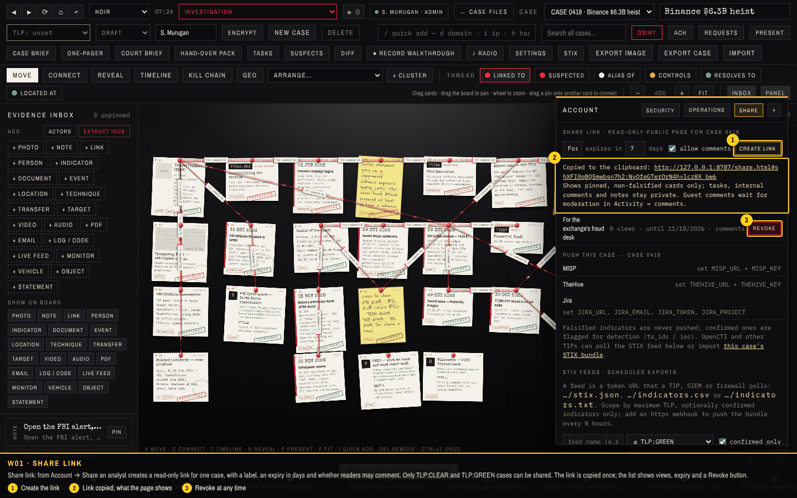
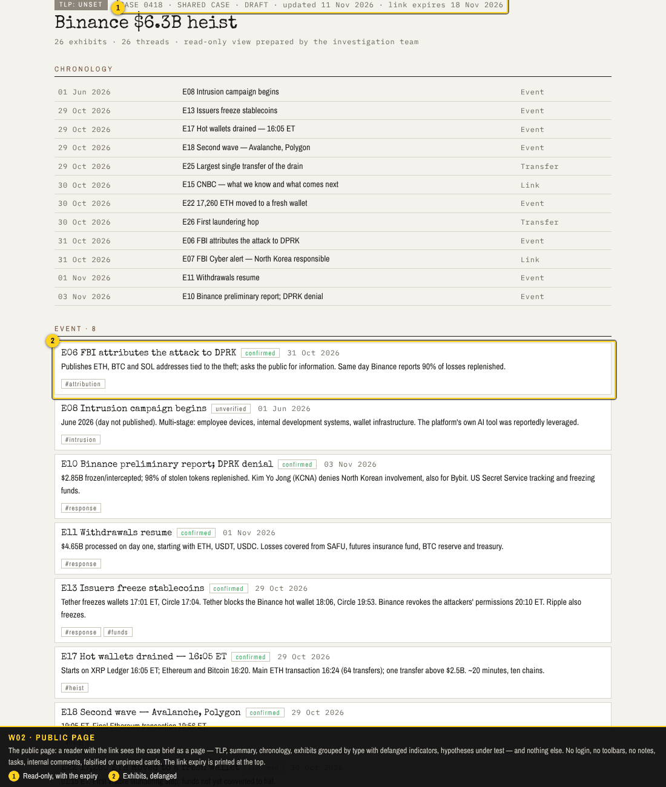
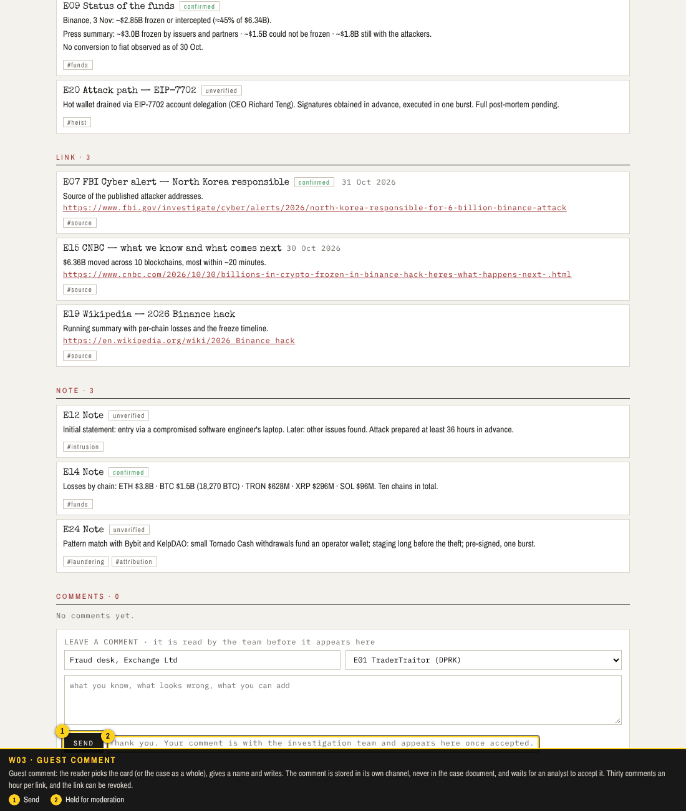
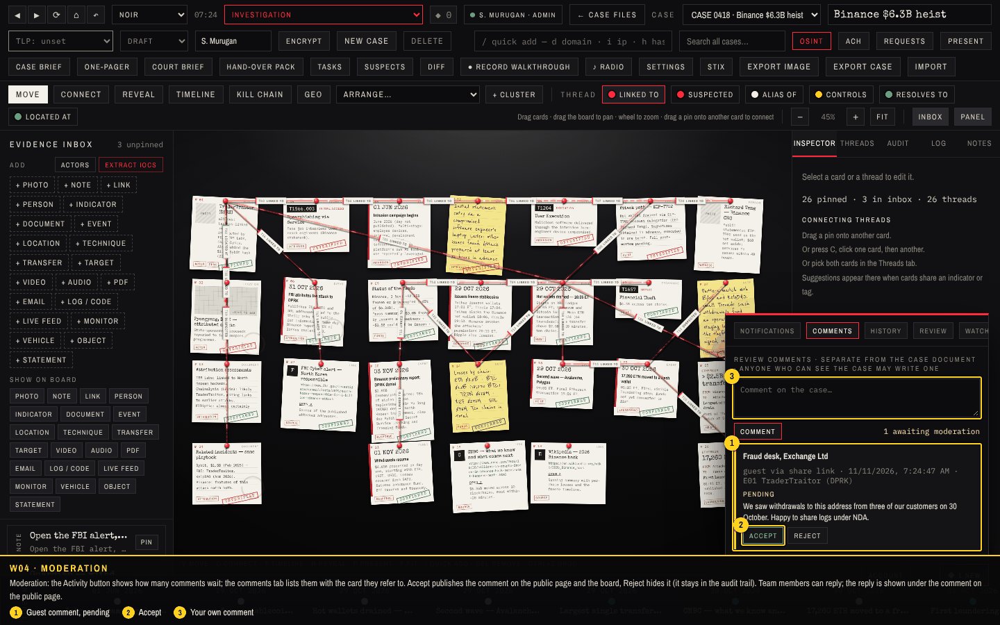
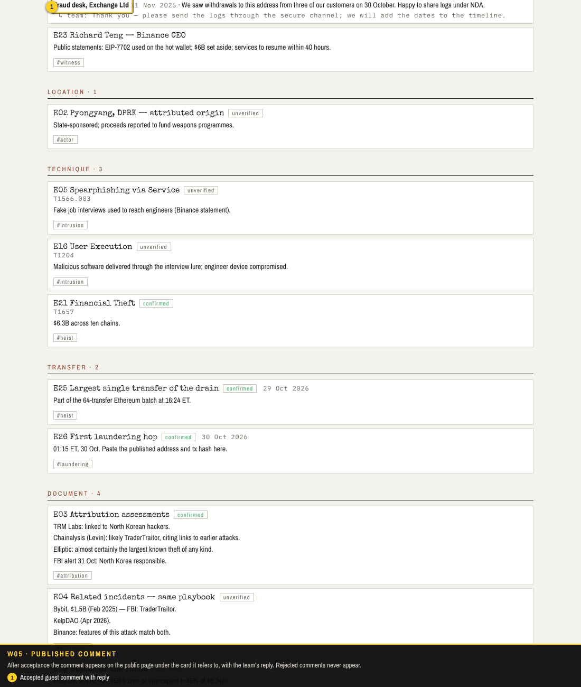
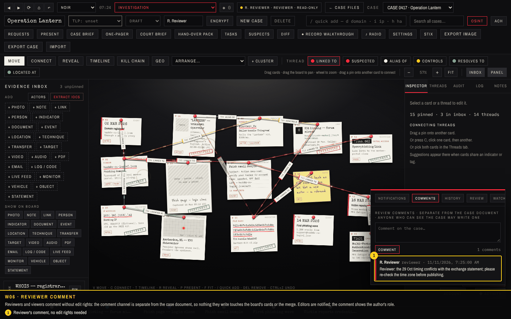
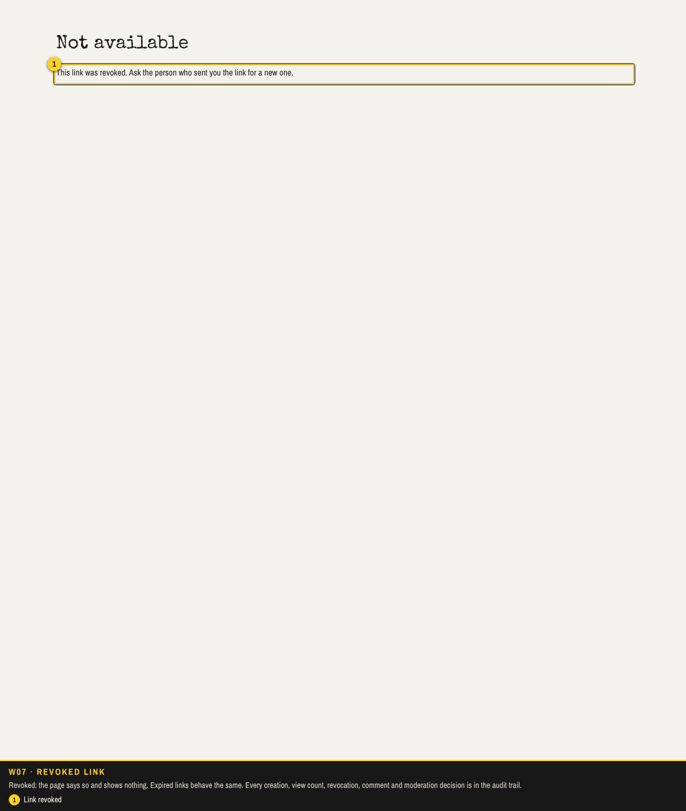

# Walkthrough 7: sharing and review

Cases used to leave the board only as files. This round lets people outside the team read a case and talk back, without ever touching the case document: a share link opens a clean read-only page for one case, readers may comment through it, and those comments wait for an analyst's decision. Reviewers and viewers inside the team get the same comment channel on the board, so review no longer needs edit rights or email. Screenshots come from `tools/capture/v7.cjs` against a fresh server; the checks are listed at the end.

| Feature | Where | What it does |
| --- | --- | --- |
| Share link | Account → Share (analysts, admins) | Token URL for one case, with label, expiry (1–365 days) and a comments switch. Only TLP:CLEAR and TLP:GREEN cases. Views are counted; Revoke ends it at once. |
| Public page | `share.html#id:token` | Brief-style page: TLP, summary, chronology, exhibits by type (defanged), hypotheses, accepted comments, the storyboard when there is one. No login, no notes, tasks, internal comments, falsified or unpinned cards. |
| Guest comments | public page | Name plus text, about the case or one visible card. Stored in their own table, rate-limited per link, pending until accepted. Editors are notified. |
| Team comments | Activity → comments (board) | Anyone who can see the case comments without edit rights; comments appear at once with the author's role. Nothing is written into the case document, so the three-way merge never sees them. |
| Moderation | Activity → comments (editors) | Accept, Reject, Reply. Accepted comments and replies show on the public page; rejected ones stay private; every decision is audited. |

## How to use it

1. **Share**: open the case on the board, **Account → Share**, give the link a label and expiry, tick *allow comments* if you want to hear back, *Create link*. It is copied to the clipboard; paste it to the recipient.
2. **Read**: the recipient opens the link in any browser. If the case is later set to TLP:AMBER or RED, the link stops working.
3. **Comment**: readers write under *Leave a comment*; team members use **Activity → comments** on the board. Select a card first to attach the comment to it.
4. **Moderate**: the Activity button shows how many comments wait. Accept, reject or reply from the comments tab.
5. **Close**: *Revoke* in Account → Share. The page then says the link was revoked.

### W01 · Share link

Share link: from Account → Share an analyst creates a read-only link for one case, with a label, an expiry in days and whether readers may comment. Only TLP:CLEAR and TLP:GREEN cases can be shared. The link is copied once; the list shows views, expiry and a Revoke button.

1. Create the link
2. Link copied; what the page shows
3. Revoke at any time

### W02 · Public page

The public page: a reader with the link sees the case brief as a page — TLP, summary, chronology, exhibits grouped by type with defanged indicators, hypotheses under test — and nothing else. No login, no toolbars, no notes, tasks, internal comments, falsified or unpinned cards. The link expiry is printed at the top.

1. Read-only, with the expiry
2. Exhibits, defanged

### W03 · Guest comment

Guest comment: the reader picks the card (or the case as a whole), gives a name and writes. The comment is stored in its own channel, never in the case document, and waits for an analyst to accept it. Thirty comments an hour per link, and the link can be revoked.

1. Send
2. Held for moderation

### W04 · Moderation

Moderation: the Activity button shows how many comments wait; the comments tab lists them with the card they refer to. Accept publishes the comment on the public page and the board, Reject hides it (it stays in the audit trail). Team members can reply; the reply is shown under the comment on the public page.

1. Guest comment, pending
2. Accept
3. Your own comment

### W05 · Published comment

After acceptance the comment appears on the public page under the card it refers to, with the team's reply. Rejected comments never appear.

1. Accepted guest comment with reply

### W06 · Reviewer comment

Reviewers and viewers comment without edit rights: the comment channel is separate from the case document, so nothing they write touches the board's cards or the merge. Editors are notified; the comment shows the author's role.

1. Reviewer's comment, no edit rights needed

### W07 · Revoked link

Revoked: the page says so and shows nothing. Expired links behave the same. Every creation, view count, revocation, comment and moderation decision is in the audit trail.

1. Link revoked

## Checks

**9 of 9 passed** in the run that produced these screenshots.

| Result | Check | Detail |
| --- | --- | --- |
| PASS | W01 setup: admin, reviewer and viewer accounts, the sample case on the board | CASE 0418 open |
| PASS | W02 create a share link from Account → Share (label, expiry, comments allowed) | http://127.0.0.1:8787/share.html#shXFI0qBQ5mwbsn7h2:… |
| PASS | W03 the public page opens without a login and shows only what is safe: pinned, non-falsified cards, no notes or tasks | 26 cards shown, no session on the page |
| PASS | W04 a guest leaves a comment on a card; it waits for moderation | 1 comment awaiting moderation |
| PASS | W05 the analyst moderates in Activity → comments: accept and reply | accepted with a reply |
| PASS | W06 the public page now shows the accepted comment with the team's reply |  |
| PASS | W07 a reviewer comments on the board without edit rights | reviewer commented on CASE 0417 |
| PASS | W08 revoking the link stops the public page; a TLP:RED case cannot be shared | revoked → 410; TLP:RED → 403 |
| PASS | no unexpected page errors |  |
