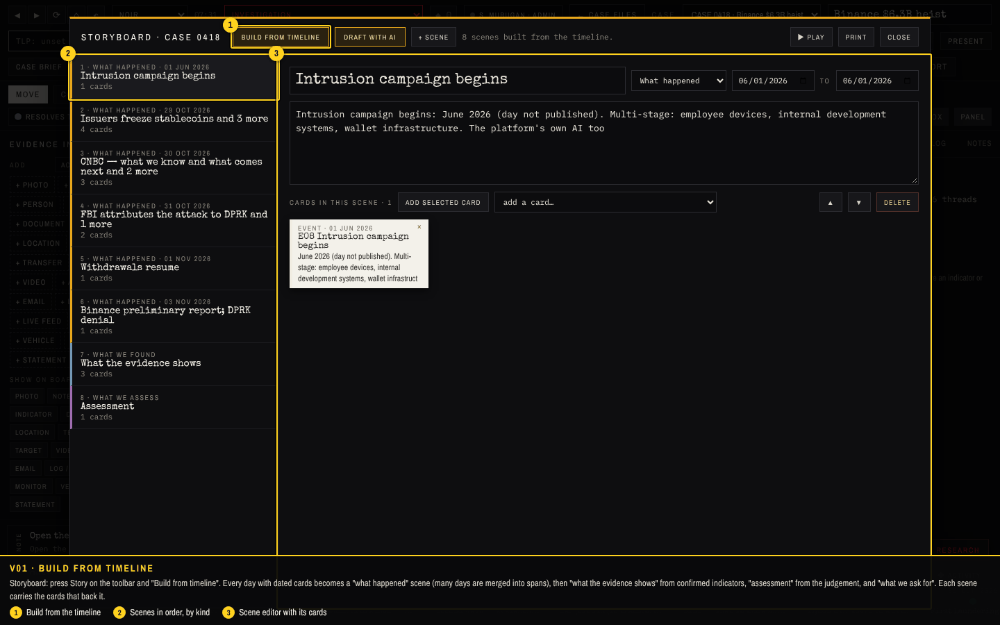
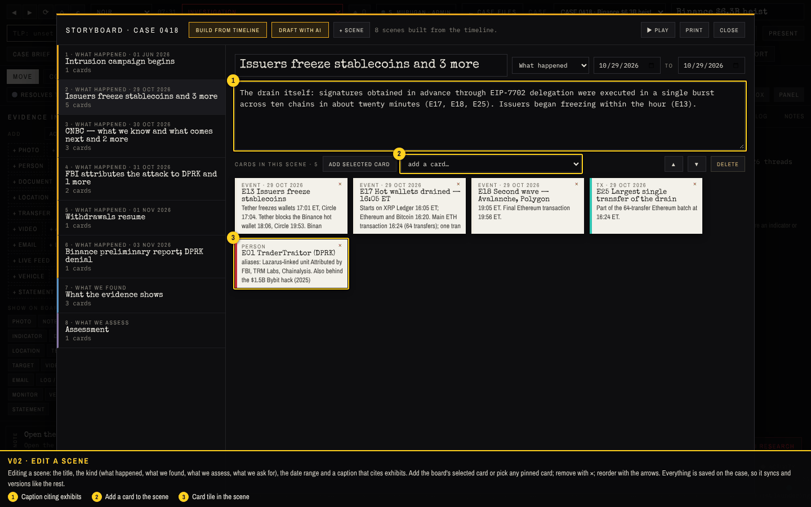
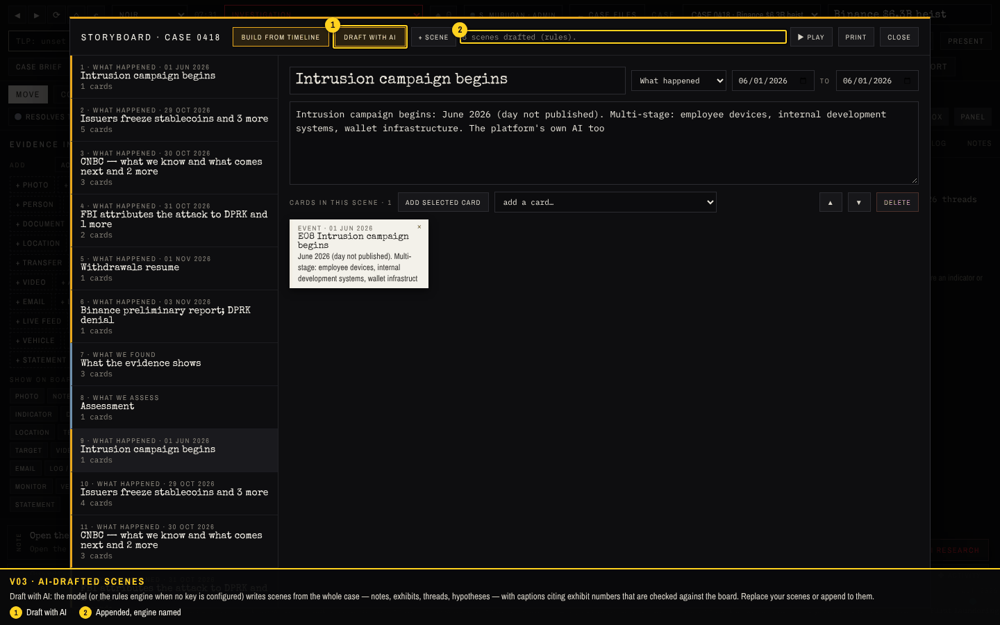
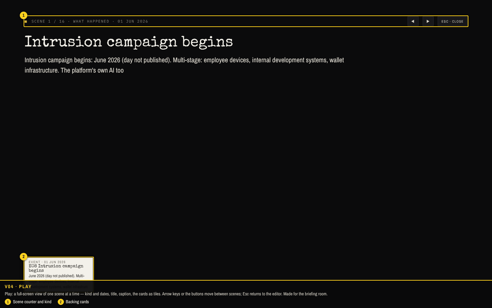
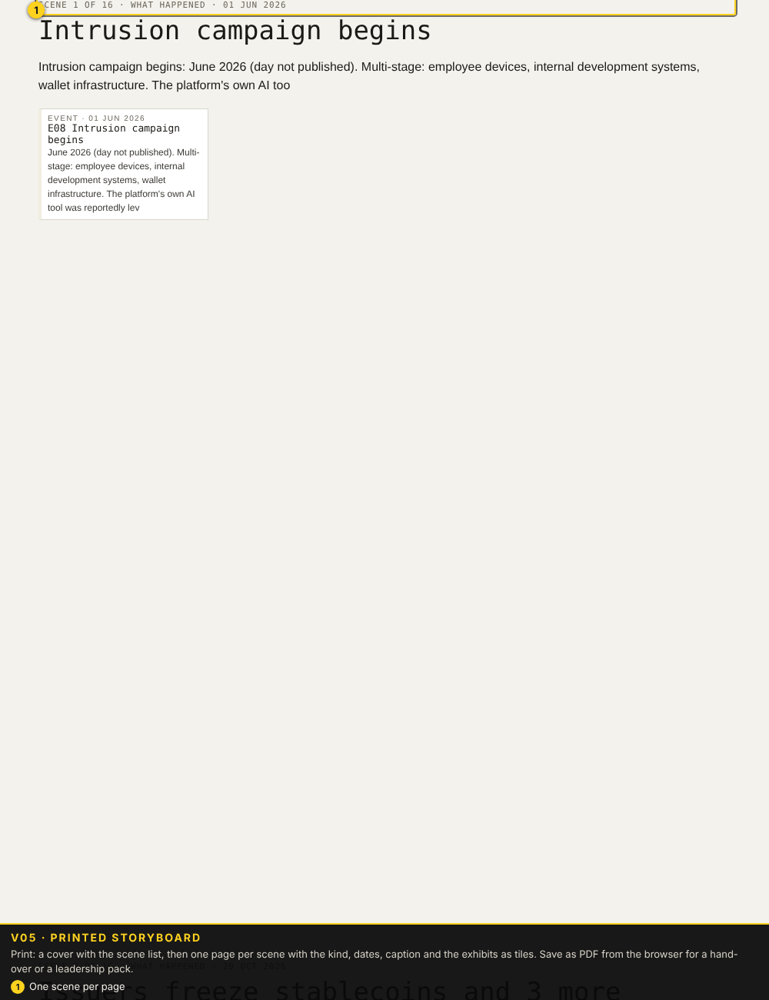
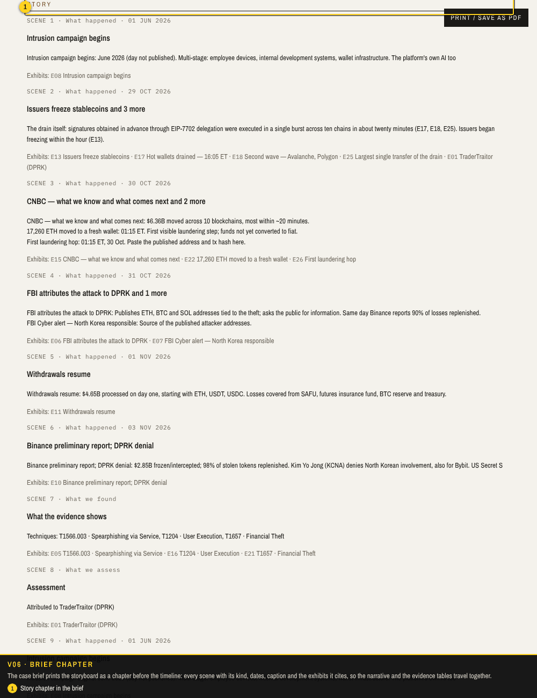
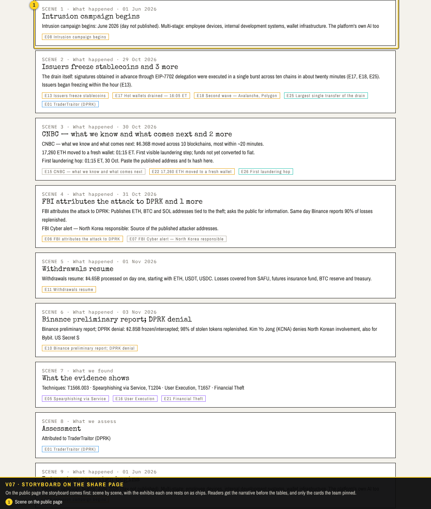

# Walkthrough 8: the storyboard

A board is for the analyst; a story is for everyone else. This round turns a case into scenes: what happened, in order and with dates; what we found; what we assess, with confidence; what we ask for. Scenes are built from the timeline in one click or drafted by the model, edited in place with the cards that back them, played slide by slide for a briefing, printed one scene per page, printed as a chapter of the case brief, and shown on the public page from the share link. Screenshots come from `tools/capture/v8.cjs` against a fresh server; the checks are listed at the end.

| Feature | Where | What it does |
| --- | --- | --- |
| Story panel | board toolbar → Story | Scenes with title, kind, date range, caption and the cards that back them. Add, reorder, delete; "Add selected card" pins the board's selection to a scene. |
| Build from timeline | Story panel | One scene per day of dated cards (merged into spans when there are many), then *What the evidence shows*, *Assessment* and *What we ask for* from the indicators, judgement and open tasks. |
| Draft with AI | Story panel | The model writes scenes with captions citing exhibits; without a key the rules engine builds the same structure. Appends to or replaces the scenes you have. |
| Play | Story panel | Full-screen playback, one scene at a time, arrow keys or buttons; Esc returns. Made for a briefing room. |
| Print | Story panel | One scene per page with the exhibits as tiles, for a hand-over or a leadership pack. |
| Brief chapter | Case brief | A *Story* section before the timeline, with each scene's kind, dates, caption and exhibits. |
| Public page | share link | The storyboard appears at the top of the shared page, scene by scene, with the exhibits it rests on. |

## How to use it

1. Open the case on the board and press **Story** (next to Kill chain).
2. **Build from timeline** or **Draft with AI** to get a first set of scenes; then edit titles and captions, change a scene's kind, and add or remove cards.
3. **Play** to present it; **Print** for a PDF; the case brief and any share link pick the story up automatically.

### V01 · Build from timeline

Storyboard: press Story on the toolbar and "Build from timeline". Every day with dated cards becomes a "what happened" scene (many days are merged into spans), then "what the evidence shows" from confirmed indicators, "assessment" from the judgement, and "what we ask for". Each scene carries the cards that back it.

1. Build from the timeline
2. Scenes in order, by kind
3. Scene editor with its cards

### V02 · Edit a scene

Editing a scene: the title, the kind (what happened, what we found, what we assess, what we ask for), the date range and a caption that cites exhibits. Add the board's selected card or pick any pinned card; remove with ×; reorder with the arrows. Everything is saved on the case, so it syncs and versions like the rest.

1. Caption citing exhibits
2. Add a card to the scene
3. Card tile in the scene

### V03 · AI-drafted scenes

Draft with AI: the model (or the rules engine when no key is configured) writes scenes from the whole case — notes, exhibits, threads, hypotheses — with captions citing exhibit numbers that are checked against the board. Replace your scenes or append to them.

1. Draft with AI
2. Appended, engine named

### V04 · Play

Play: a full-screen view of one scene at a time — kind and dates, title, caption, the cards as tiles. Arrow keys or the buttons move between scenes; Esc returns to the editor. Made for the briefing room.

1. Scene counter and kind
2. Backing cards

### V05 · Printed storyboard

Print: a cover with the scene list, then one page per scene with the kind, dates, caption and the exhibits as tiles. Save as PDF from the browser for a hand-over or a leadership pack.

1. One scene per page

### V06 · Brief chapter

The case brief prints the storyboard as a chapter before the timeline: every scene with its kind, dates, caption and the exhibits it cites, so the narrative and the evidence tables travel together.

1. Story chapter in the brief

### V07 · Storyboard on the share page

On the public page the storyboard comes first: scene by scene, with the exhibits each one rests on as chips. Readers get the narrative before the tables, and only the cards the team pinned.

1. Scene on the public page

## Checks

**10 of 10 passed** in the run that produced these screenshots.

| Result | Check | Detail |
| --- | --- | --- |
| PASS | V01 setup: admin and the sample case on the board | CASE 0418 open |
| PASS | V02 build the story from the timeline: one scene per day, then evidence, assessment and asks | 8 scenes: happened, happened, happened, happened, happened, happened, found, assess |
| PASS | V03 edit a scene: caption, kind and the cards it rests on | caption set, 5 cards in scene 2 |
| PASS | V04 draft with AI appends scenes written from the whole case (rules engine without a key) | 8 → 16 scenes |
| PASS | V05 play the story full screen, one scene at a time | advanced with →, closed with Esc |
| PASS | V06 print: one scene per page with its exhibits | 17 pages for 16 scenes |
| PASS | V07 the case brief gains a Story chapter before the timeline | Story chapter present before Timeline |
| PASS | V08 the public share page shows the storyboard first | 16 scenes on the public page |
| PASS | V09 the story survives a reload and is part of the case document | 16 scenes on the server |
| PASS | no unexpected page errors |  |
